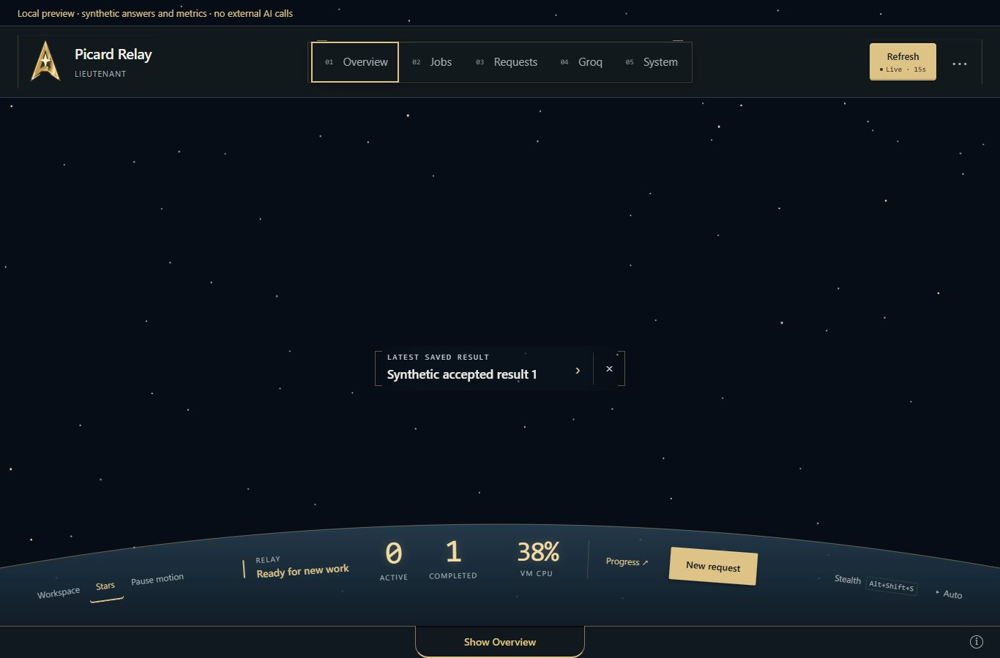
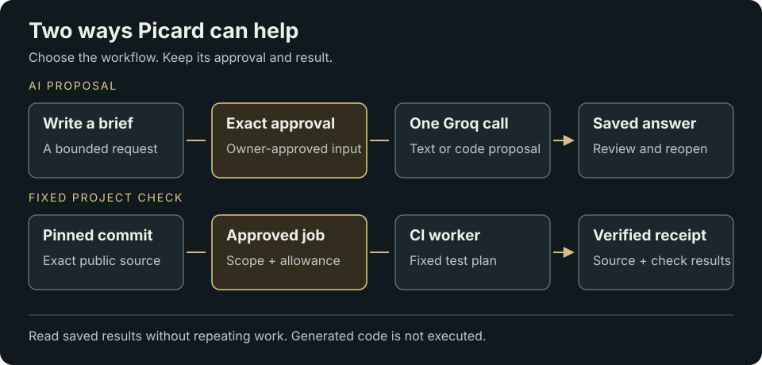

# Picard Relay

<a id="your-relay-your-cockpit"></a>

**Give Picard a task. Keep the answer.**

Picard is a small, self-hosted AI workspace. Turn a rough note into a checklist,
ask for a code proposal, or get help with a task. Review the exact request before
sending it once, then reopen its saved answer whenever you need it.

<a id="choose-your-starting-point"></a>

## Get started

**New to Picard? [Set up your relay →](docs/SETUP.md)**

The guided setup prepares an existing Linux machine, installs the runtime and
HTTPS, and helps you connect your Groq Free project. It makes no AI call during
setup. You create your owner sign-in in the browser, then send your first task.

Already have a relay? **[Turn a rough note into a saved checklist →](docs/QUICKSTART.md)**

The setup candidate targets fresh Ubuntu 22.04/24.04 or Oracle Linux 9 hosts
with a public hostname. It refuses existing installs; updater and key-replacement
host support remain separate. See the guide's [qualification and limits](docs/SETUP.md#qualification-and-limits).
Want to explore first? The [local demo](#try-it-locally) needs no provider key.

[](docs/COCKPIT-TOUR.md)

*Curved cockpit layout with synthetic local data. The [15-second walkthrough](docs/images/picard-cockpit-walkthrough.gif)
records an earlier v1.0.33 release; the [tour](docs/COCKPIT-TOUR.md) explains the current controls.*

<a id="try-it-locally--no-account-or-api-key"></a>
<a id="try-it-locally"></a>

## Try it locally — synthetic demo

Install Git and **Node.js 24**. There are no npm dependencies to install.

```sh
git clone https://github.com/bmartynowicz/picard-relay.git
cd picard-relay
npm run demo
```

The demo ends with `One synthetic request, one stored answer, duplicate replay suppressed.`
For the cockpit and request workflow, run:

```sh
npm run preview:v1
```

Open the printed loopback address. Both demos use synthetic data and make no AI
provider call. The interface preview is temporary; it is not a production install.
Stop it with Ctrl+C. Full checks also require OpenSSL and are qualified on Linux.

<a id="v1-request-workspace"></a>
<a id="what-is-here"></a>

## What you can do

- **Approve useful work.** Send a short brief to the configured Groq model,
  follow its progress, review the saved answer, and copy or download it.
- **Come back later.** SQLite retains request identities and saved answers.
  Reconnecting reads the existing result instead of asking the model again.
- **Connect an assistant.** Read-only MCP tools expose status, history and results.
  The opt-in agent adapter also prepares drafts and submits only the exact work
  separately approved by the owner. Tool access is revocable and independent
  of browser sign-ins.
- **Check a change through Picard.** A separate, enrolled compute broker runs
  fixed public-project CI checks on one approved commit and returns a verified
  receipt. This is distinct from generating a text/code proposal.
- **Make it your cockpit.** Curved controls, expanding reading panels, optional
  stars, whole-VM CPU, earned ranks and Stealth Mode keep the essentials nearby.
  Motion can be paused; reduced motion is respected. Effects run in your browser.
- **Operate your relay.** Inspect health and installed identity, use the connected
  update button, replace an enrolled Groq key and inspect recorded workflow usage.



Text equivalent: a brief goes through exact approval and one Groq call to a
saved answer. A pinned public commit goes through an approved fixed CI job to a
verified receipt. Reading either saved result does not repeat execution.

<a id="what-is-not-here"></a>
<a id="safety-and-cost"></a>

## What to expect

The live text adapter is fixed to **Groq `openai/gpt-oss-20b`**: one call per
approval, at most 4,096 output tokens, no model tools, generated-code execution,
automatic retries or paid fallback. Request and context fields each allow up to
4,000 characters, with a combined byte limit. See [complete limits](docs/LIMITATIONS.md).

An uncertain outcome keeps its evidence and stops. Completed means an answer
was saved, not that it is correct or that a change was accepted, merged or
deployed. Saved-result recovery can remain available when new work is blocked.

The runtime uses Node.js and SQLite without package dependencies. The
[guided setup candidate](docs/SETUP.md) prepares a fresh Linux host and workspace;
existing hosts use their enrolled configuration. Signed updates replace allowed
runtime source, while host setup, credentials and saved state stay separate.
GitHub publishes releases; an enrolled host updater installs them.

Free-plan enrollment and no-paid-fallback controls are retained safeguards,
not a live billing guarantee. Fixed CI jobs have separate provider/allowance
rules. A CPU gauge does not measure available provider quota or budget.

<a id="experimental-progress"></a>

## Current status and next work

Read [dated evidence](docs/STATUS.md) for the tested source and verification
scope. Each host has its own installed version; inspect System in your relay
when you need its current identity.

Unfinished areas include fresh-host installer qualification, a reusable
task-board connector, broader execution/provider support and the
physical voice badge. See [known work](docs/WORK-REGISTER.md) for the dated source
snapshot. The owner's private board is the operational backlog and is not bundled.

<a id="reuse-and-contributions"></a>

## Build and contribute

After your first request: [connect a coding assistant](docs/WORKSPACE-AGENT.md),
[check a public commit](experimental/compute-broker/CODING-WORKFLOW.md), or
[maintain your host](docs/OPERATIONS.md). [All guides](docs/README.md) ·
[Known work](docs/WORK-REGISTER.md)

**For AI companions:** [llms.txt](llms.txt) → [project map](docs/project-map.json) → [contributor instructions](AGENTS.md).

Read [AGENTS.md](AGENTS.md) and [Development](docs/DEVELOPMENT.md). The signed
runtime lives in `experimental/runtime-control/src/`; top-level `src/` is the
separate offline preview. Generated proposals are never executed automatically.

[MIT License](LICENSE). Picard is a project nickname, not an affiliation or
endorsement. In tribute to Sir Patrick Stewart.
