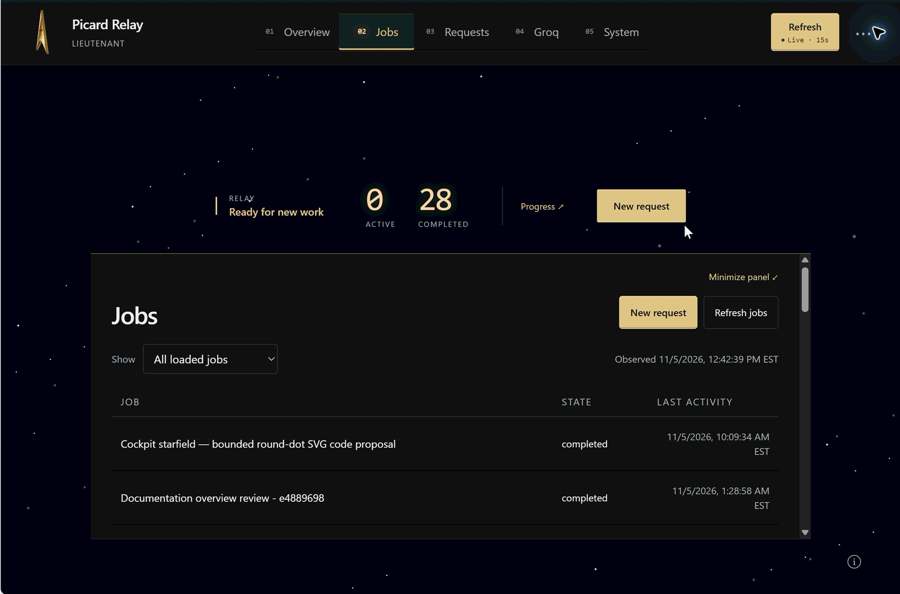
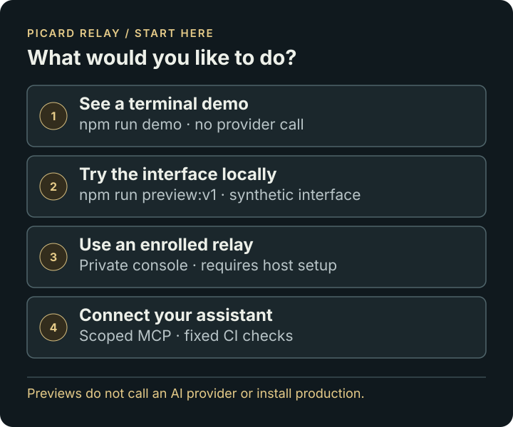
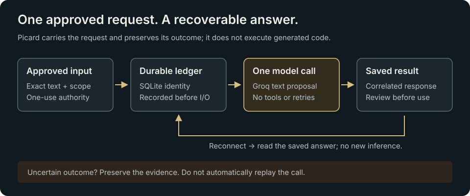

# PICARD RELAY

A small Node.js + SQLite relay that takes an exact approved AI request, sends it once, and preserves the saved result for recovery. It does not execute generated code.

**Start here:** [What it does and how to use it](docs/QUICKSTART.md) · [Documentation](docs/README.md) · [Limitations](docs/LIMITATIONS.md) · [Known bugs and features](docs/WORK-REGISTER.md) · [For AI tools](llms.txt)

## Your relay. Your cockpit.

Keep the essentials in view. Open the detail when you need it.

[](docs/COCKPIT-TOUR.md)

**[Take the cockpit tour](docs/COCKPIT-TOUR.md)** · [Watch the 15-second GIF](docs/images/picard-cockpit-walkthrough.gif) · [Video file (MP4)](docs/images/picard-cockpit-walkthrough.mp4)

Recorded on the enrolled v1.0.33 relay. The console now has a **Cockpit** button
beside Refresh. Select a view to open its reading deck, or click exposed space to
retract it. The tour covers controls, ranks and current limits.

## Choose your starting point



[Terminal demo](docs/QUICKSTART.md#try-the-offline-demo) · [Interface preview](docs/V1.md) · [Enrolled host](docs/OPERATIONS.md) · [Developer and AI guides](llms.txt)



<details>
<summary>Picard Relay insignia</summary>

```text
                    ###
                   ## ##
                  ##   ##
                 ##     ##
                ##       ##
           ######        #######
         ####  ##    #    ##  ####
       ###    ##     #     ##    ####
     ###      #      ##     ##      ##
    ##       #      ###     ##       ##
  ###       ##      ###      ##       ###
  ##       ##       ###       ##       ##
 ##        #     #########     #        ##
 ##       ##       #####       ##       ##
##       ##        ##  ##       ##       ##
##       #                       #       ##
 ##     ##                       ##     ##
 ##     #             #######     #     ##
  ##   ##          ####     ###   ##   ##
  ### ##         ###          ##   #  ###
   #####       ###             ##  ####
     ##      ###                ## ###
     ##    ###                   #####
     ##  ####                 ########
     # #### #######    ########    ###
    #####        #########          ##
    ###                              #
    #

           P I C A R D  R E L A Y
                MAKE IT SO.
```

</details>

*In tribute to Sir Patrick Stewart.*

**Small ship. Durable messages. No surprise warp jumps.**

Built for modest hardware, Picard preserves request identity, stores correlated responses and does not automatically retry an uncertain invocation.

**Status: offline preview plus separately enrolled signed runtime.** The simplest working entry point is an offline demo. The signed-runtime source supports an exact-scoped Groq text adapter, private authenticated console and opt-in signed updates after separately reviewed host enrollment. It is not a portable board application or universal provider router. This repository stores code and signed source envelopes. **GitHub Actions tests, signs and publishes source releases only; it never deploys.**

## V1 request workspace

The v1 source adds ordinary request creation, exact-input approval, named job history, saved answer/code downloads, provenance handoff and persistent owner reviews. It reuses the durable one-call relay and existing Groq enrollment. Read the [v1 guide](docs/V1.md) and [machine-readable workspace contract](docs/workspace-contract.json).

The [earlier 27-second workspace demo](docs/images/picard-relay-interface-demo.gif)
shows request creation and saved-result review in the older layout using synthetic
data. For the current interface, use the [cockpit tour](docs/COCKPIT-TOUR.md).

Try the complete workflow locally with Node 24:

```sh
npm run preview:v1
```

Open the printed loopback address. This is a clearly marked synthetic preview with disposable storage and no external AI calls. The production owner workspace requires explicit host activation; current installed verification remains separately recorded in [Status](docs/STATUS.md).

## Try it locally — no account or API key

Install Node.js 24 (includes `node:sqlite`), Git, and the OpenSSL CLI for the local TLS test. No npm dependencies are required.

```sh
git clone https://github.com/bmartynowicz/picard-relay.git
cd picard-relay
npm run demo
npm test
```

The commands also work from PowerShell. The demo uses synthetic text, creates no listener, and makes no network request. Some permission-sensitive production adapter tests use POSIX filesystem semantics; the complete suite is qualified on Linux, not native Windows.

Expected demo ending: `One synthetic request, one stored answer, duplicate replay suppressed.`

## What is here

- Durable SQLite outbox, leases, replay detection, crash reconciliation and signed request/response protocol.
- Offline fixtures and real separate-process SQLite race/crash tests.
- A fixed Groq `openai/gpt-oss-20b` text-only adapter, disabled by default. No tools, paid fallback, automatic model substitution or automatic inference retries.
- A durable one-shot adapter with legacy `Reply Hello World` support and exact approved review/proposal requests. The v3 gate separates retained Free-policy enrollment from each request's short expiry; generated text/code remains inert and no tool execution is enabled.
- Loopback-only HTTP receiver suitable for a separately configured TLS reverse proxy.
- Fixed-endpoint native HTTPS transport compatible with `node --jitless`; certificate verification stays on. A local TLS fixture tests the adapter without calling Groq.
- [Manual deployment notes](docs/DEPLOYMENT.md), configuration templates and [verification boundaries](docs/STATUS.md).

## Experimental progress

The [bounded next candidate](docs/NEXT-CANDIDATE.md) adds an explicit Free-only
one-shot routing policy in the signed-runtime source, deterministic local fixture
tasks, sanitized diagnostics on the existing signed health action, and an offline
mission-control presentation. It adds no production executor or browser endpoint.
Run `npm run demo:fixtures` or `node examples/mission-control.mjs --output preview.html`
for synthetic local demonstrations; `npm run test:candidate` tests that candidate.
See [the core improvement bundle](docs/CORE-IMPROVEMENT-BUNDLE.md) for the current
local reliability, private-history and console candidate and its review boundaries.

The [updater and runtime-control source](experimental/README.md) is separate from
the top-level offline preview. Example enrollment remains disabled by default.
Every host requires explicit enrollment and verification of signature, immutable
source identity, real Unix-socket controls and rollback behavior; this is not a
one-command production installer.

## What is not here

A hosted service, your task board, provider credentials, an autonomous coding agent, an unrestricted API proxy, or a one-command production installer. The original board integration is application-specific and is not bundled. Its client must implement the signed protocol and authorization checks; do not treat the local fixture as a production board adapter. The unavailable assistant adapter fails closed; it does not silently substitute another provider.

## Safety and cost

`npm start` is disabled unless explicitly configured. Keep the backend on loopback and use authenticated HTTPS in front of it. Never commit keys, HMAC secrets, credentials, runtime databases, certificate state or request content.

A "Free" enrollment retains an operator's original account-plan evidence and exact account/project/key/model binding; it is **not a live billing API check or a monetary guarantee**. Each request still needs separate exact approval and expiry. Relevant configuration changes or payment/quota contradictions stop reuse for operator review. Do not upgrade billing, substitute a paid fallback or retry an uncertain call to make a demo pass.

## Reuse and contributions

Released under the [MIT License](LICENSE), as selected by the repository owner. This is an early source preview. No third-party music, images or character artwork are included. Picard is a project nickname, not an affiliation or endorsement.

Manual review and deployment remain deliberate operator actions. GitHub may build, sign and publish source; installation remains a separately enrolled host action.
