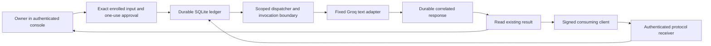

# Architecture and request lifecycle

Picard uses Node.js and built-in SQLite. The signed runtime is a small loopback service behind an independently configured HTTPS proxy. Browser authentication, signed client transport, request approval and provider cost enrollment have different jobs; none substitutes for the others.

The arrows describe logical responsibilities. The finite-admission path and the legacy signed bridge have separate validation entrypoints and converge on durable dispatch; they are not interchangeable approval mechanisms.

## Authority boundaries

| Boundary | Responsibility |
| --- | --- |
| HTTPS proxy | Trusted TLS and routing to a loopback listener. It does not grant provider authority. |
| Owner session | Permits private console reads and the supported owner approval flow. It is not arbitrary task execution authority. |
| Signed bridge | Authenticates transport, exact payload identity, time and nonce. The server still validates request scope and availability. |
| Finite catalogue | Fixes owner/task/model, exact input/context hash, request/grant identities, slots and expiry. |
| Approval proof | Binds the authenticated owner session to one enrolled entry, slot and input hash. |
| Retained cost enrollment | Binds the allowed Free-policy account/project/key/model evidence. This is configuration evidence, not a current billing check. |
| Durable marker and invocation state | Consume one-shot authority before external I/O and prevent an uncertain outcome from being replayed. |

The current provider is Groq `openai/gpt-oss-20b`. There is no automatic provider/model substitution, paid fallback, tool use or execution of generated commands.

## States and recovery

| State | Meaning / action |
| --- | --- |
| `available` | A catalogue slot has not yet been registered; this alone is not approval. |
| `queued` | An exact request is durably registered. |
| `claimed` | A worker holds a bounded lease. |
| `invoking` | The durable invocation boundary has been crossed; external I/O may have occurred. |
| `completed` | A correlated reply is saved. Recover it rather than invoking again. |
| `failed`, `blocked`, `cancelled` | Terminal recorded outcomes. They do not restore spent authority. |
| `uncertain` | An external outcome cannot be proved. Stop and retain the evidence. |
| `unknown` | The current observation cannot establish a state; do not infer availability. |

The store enforces identity, uniqueness and lease ownership. Reconciliation can complete bookkeeping for an already persisted response without contacting the provider. Expired work that may already have invoked is not treated as a fresh dispatch. Restart and result retrieval therefore have different implications from new request submission.

This is an at-most-once invocation design with explicit uncertainty. It does not promise that every approved request will complete or that an external model response can always be recovered after an arbitrary failure.

## Console and release identity

`oracle-service.mjs` embeds the base console and its owner authentication. `admission-ui.mjs` composes the Requests view when finite admission is enabled. Status and job-list projections omit request/result bodies; authenticated request-specific recovery is a separate surface.

The installed source lives under an immutable versioned release directory. Runtime identity checks verify the physical source tree against its manifest. A publisher signature is verified by the enrolled updater, not inferred from an environment version label. Runtime source, host support code, configuration and durable state have separate update boundaries; see [Operations](OPERATIONS.md).

The [project map](project-map.json) points to the implementing modules and the [API reference](API.md) describes the interfaces.
