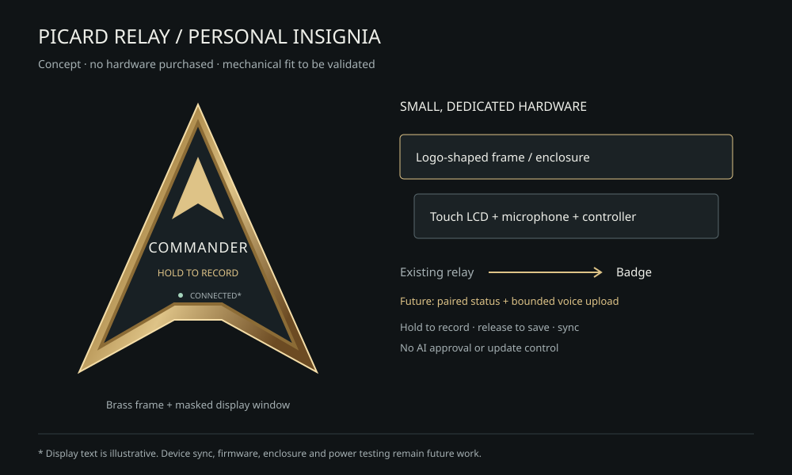

# Physical Picard badge: first prototype

Research/design, November 5, 2026. No parts bought, device manufactured, firmware
flashed or device access credential created. The hardware itself cannot be built
for $0 unless suitable parts are already available.

## Parts comparison

Official listings checked in USD on November 5. Prices are component references,
not delivered quotes; availability, shipping, tax and extras remain separate.

| Approach | Observed components | Starting subtotal | Fit |
| --- | --- | ---: | --- |
| Integrated microcontroller + LCD | [Waveshare ESP32-S3-LCD-1.28](https://www.waveshare.com/esp32-s3-lcd-1.28.htm), SKU 26541: **$15.99**, includes controller, Wi-Fi and 1.28-inch round 240×240 display | **$15.99** | Best first hardware candidate for a small dedicated badge |
| Linux board + LCD | [Raspberry Pi Zero 2 W](https://www.raspberrypi.com/products/raspberry-pi-zero-2-w/): official advertised **$15**; [Waveshare 1.3-inch LCD HAT](https://www.waveshare.com/1.3inch-lcd-hat.htm), SKU 14972: **$13.99** | **$28.99** | Easier general-purpose development; larger assembly, SD card/OS upkeep |

The [ESP32 manufacturer's specifications](https://docs.waveshare.com/ESP32-S3-LCD-1.28)
describe 2.4 GHz Wi-Fi, USB-C and an onboard battery charging connection. These
are integration options, not evidence of runtime, battery life or security
qualification for our badge. Pi Zero 2 W has an unpopulated GPIO footprint; HAT
use needs suitable headers/assembly. The Pi's $15 is the manufacturer's advertised
board price, not a confirmed in-stock retailer checkout price.

Both options still need power/cable, a logo-shaped enclosure and a stand or
attachment. Pi also needs a microSD card and likely headers. No verified quote
for those extras exists yet. Start USB powered; battery packaging, charge safety,
thermal testing and wearability are separate design work. A custom silhouette
may mask part of the rectangular/round screen. Check the actual mechanical
drawing and build a cardboard fit model before CAD or buying a case.

**Recommendation:** use an already-owned screen/browser for the first visual
mockup. If hardware is later authorized, start with the integrated ESP32/LCD;
Linux is unnecessary for simply displaying a small rank/status snapshot. This
is an engineering inference from the documented parts, not a measured power
comparison or purchase recommendation under the current $0 scope.

## Hold to record and sync

Brian clarified the device interaction: **hold to record a voice note, release to
save it, then sync to the owner's Picard Relay**. Keep the rank display, with a
clear recording indicator and offline/synced state. No always-listening mode is
requested. Losing connection must not lose a saved clip.

The $15.99 comparison board is a display/controller baseline, not a complete
recording badge. It needs a microphone and a suitable hold control. An official
[Adafruit ICS-43434 I2S microphone breakout](https://www.adafruit.com/product/6049)
was listed at **$8.95** on November 5, making those two components **$24.94** before
control, wiring, storage, power and enclosure. Electrical/pin/firmware fit is not
qualified. The alternative [Waveshare ESP32-S3-Touch-LCD-1.85C V2](https://docs.waveshare.com/ESP32-S3-Touch-LCD-1.85C)
already documents a touchscreen and dual microphones; its price, size and battery
package need a fresh complete quote. V1/V2 audio hardware differs, so firmware
must bind the actual revision. This replaces the display-only recommendation as
the hardware selection criterion.

Run `node examples/badge-preview.mjs` for a loopback-only interaction prototype.
It simulates hold/release, queued clips, offline state and sync acknowledgements.
It has no microphone permission, real audio, persistent storage, network sync or
device credential. Its synthetic labels are intentional; it cannot establish
hardware acceptance or real recording quality.

## Proposed device sync boundary

The status download should show only insignia, rank and connection/freshness.
Voice uploads are a separate narrow permission. Neither direction needs provider
keys, owner passwords, request approval grants or update control.

For eventual device endpoints, define separate revocable **badge.read** and
**voice.create/status** permissions, limited to one owner. Pair them through an
authenticated owner action; never put a bearer secret or owner password in a
URL, QR link, public page, log or repo. Require certificate validation, bounded
response size and a conservative status polling interval (e.g. once per minute).
Cache the last display, mark it stale on missed checks, and make revocation stop
new reads/uploads. Neither badge permission may approve AI requests or change
updater state. Endpoint enrollment and credential creation require their own reviewed
implementation and owner authorization; none was added here.

Proposed first audio envelope: at most 30 seconds, mono 16 kHz/16-bit PCM WAV
(960,000 audio bytes plus header), bounded private storage and a small offline
queue. These are reviewable initial limits, not a supported API. Preserve one
clip ID and content SHA-256 through upload/status recovery; acknowledge only an
atomic stored match and never silently replace the clip. An upload must not queue
an AI call. Current Picard is text-only: audio intake, storage limits, playback,
retention/deletion and any transcription are unfinished features. Transcription
cannot silently introduce a paid service or a large model on the lightweight VM.

Current Picard allows **one active owner session**. Signing the physical badge in
as the owner would sign out the normal console and grant too much authority.
Reusing the owner cookie/password is therefore not the sync design.

The current in-memory source rank projection is already small; only the above
minimal status subset should cross the future status-download boundary.
The illustration is a no-network concept preview, not a connected badge. The
existing synthetic console can demonstrate Commander/Captain using
`PICARD_PREVIEW_ACCEPTED_RESULTS=5` or `25` with `npm run preview:v1`.

## Remaining work

Confirm size and desk-versus-wearable use; validate the screen/enclosure fit;
inventory any existing parts; obtain a full delivered BOM only if spending is
authorized; implement and test pairing/revocation, bounded audio storage and
status recovery; then qualify touch/hold recording, firmware, TLS, offline
display and actual power consumption on the
chosen hardware. Software simulation does not count as a built physical device.

Picard supplied initial design notes, which were reviewed and corrected. Its
suggestion that an ESP32 simply reads a local Linux file and its unsupported
performance claims were not used as hardware evidence.
