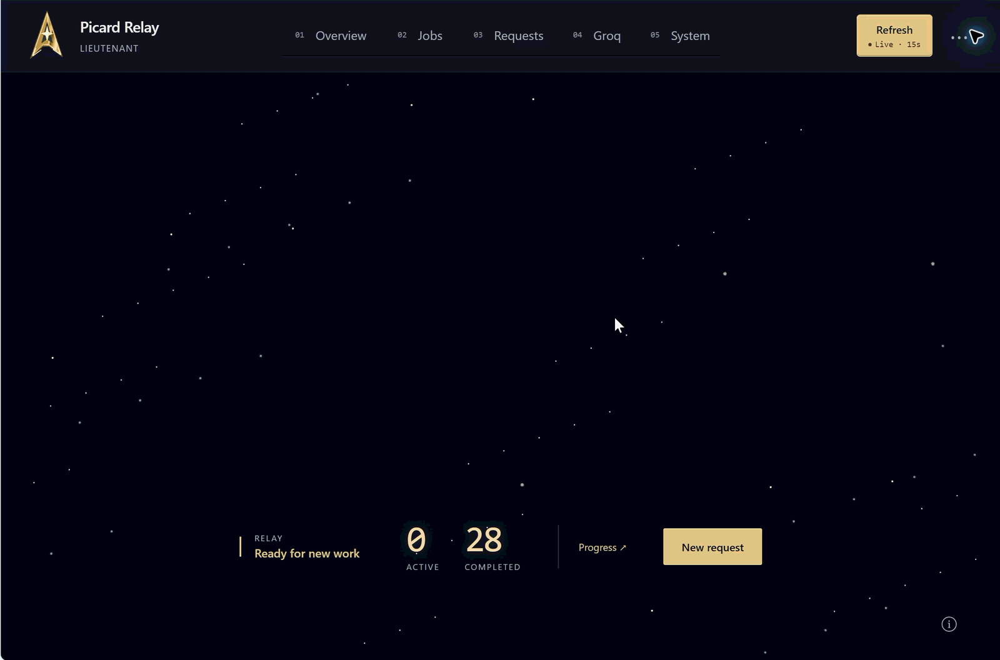
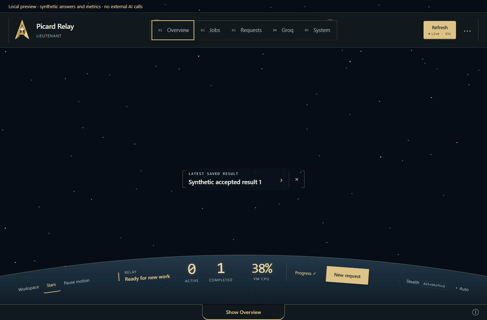
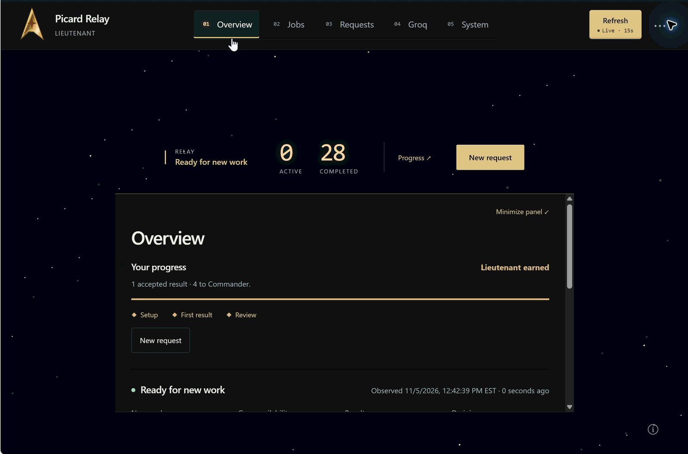

# Your relay. Your cockpit.

Keep the essentials in view. Open the detail when you need it.

Picard Relay gives bounded AI work a small, self-hosted home: approve a request,
follow the job, then return to its saved answer. The cockpit puts readiness,
activity and your next action in front of a slowly moving starfield.

**[Watch the 15-second walkthrough](images/picard-cockpit-walkthrough.gif)** ·
[Video file (MP4)](images/picard-cockpit-walkthrough.mp4) ·
[AI-readable tour](interface-tour.json)

The silent recording shows the enrolled v1.0.33 console on November 5, 2026.
The displayed Lieutenant rank and 28 completed jobs belong to that recorded
relay. Your own relay shows its own work and progress.

The recording predates the VM power reading and look-around controls added in
v1.0.34. The steps below describe the current source; the timeline describes
only what the recording shows.

## Take the controls

1. **Enter the cockpit.** Sign in and select **Cockpit view** above Overview. The
   top-left insignia also switches views after five quick activations.
2. **Read the essentials.** Readiness, active/completed counts, **Progress** and
   the next action stay together on the windshield. Select the counts to open
   Jobs, readiness to open System, or Progress to open Overview.
3. **Open a panel.** Choose a view in the centered navigation. Its number lights
   up and a translucent panel grows from that control. The header stays opaque;
   stars remain visible behind the reading surface.
4. **Clear the view.** Click exposed starfield, choose **Close panel**, or press
   Escape. The deck retracts while your current draft or selected result stays
   in place. Clicking inside the deck keeps it open.
5. **Set the display.** The rail beneath the HUD holds **Workspace**, **Stars** and motion on the left, with **Stealth** and **Auto**
   on the right. These controls follow the same curve as the glass. The
   Stealth switch shows its keyboard shortcut. **Resume display** brings back your
   last layout. Refresh and **Live · 15s** stay at the upper right beside the account menu.

The browser remembers Cockpit and stars separately. A compact windshield readout
prioritizes uncertain or active work, then the latest saved result. Select a saved
result to expand its answer across the windshield. Dismiss the readout with ×;
restore it with **Show windshield readout** in the account menu.

Main panels, VM CPU and Auto share one transition: the old panel folds into its
control before the next opens. Click the same control, Close or exposed space,
or press Escape to retract it. Reduced motion skips these animations.

This image is a local source preview, not an installed-host or release claim.

Refresh reads status.
Reload the browser page to load a newly installed interface. The update button
requires a separately connected host updater. See
[Updating your relay](OWNER-UPDATES.md).

## Read the power gauge and look around

In current releases, **VM CPU** shows utilization of the whole supporting VM.
Select it for VM memory, Picard's RAM and the sample time. `0%` is a measured
zero; `—` means unavailable. These readings also appear in System. They do not
measure provider quota, remaining credits or Picard alone.

Move the pointer over exposed space, or focus the space view and use the arrow
keys. The background shifts slightly while the HUD and controls stay fixed.
Higher measured VM CPU gently increases star travel, capped at 1.3×. Pause
motion and reduced motion stop this effect. See [Flight instruments](FLIGHT-INSTRUMENTS.md)
for the sampling, motion and small-machine limits.

## What each view gives you

| View | Use it to |
| --- | --- |
| **Overview** | Continue onboarding, see rank progress, check readiness and recent work. |
| **Jobs** | Find a previous job and reopen its saved result. |
| **Requests** | Write a brief, review the exact limits, approve one call and review the answer. |
| **Groq** | Check the configured provider's availability and recent relay activity. |
| **System** | Read the installed version, health and updater status. |

The main action follows your next step: finish setup, continue a request, review
a result or start new work. Ranks introduce capabilities as you learn the
workflow; later ranks reflect accepted results. The spinning brass insignia
gains detail as you advance. See [ranks and unlocks](OWNER-FEATURES.md#earned-work).

## The walkthrough, in order

Times are approximate; transitions cross the segment boundaries.

| Time | What you see |
| --- | --- |
| 0–3 seconds | The compact windshield, rotating insignia, moving stars and projected counts. |
| 3–7 seconds | Jobs opens in a broad reading deck while the instruments remain visible, then retracts. |
| 7–12 seconds | Overview opens; scrolling reveals progress, readiness, outcome totals and recent activity. |
| 12–14 seconds | Groq and System use narrower decks. System shows v1.0.33 and its source identity. |
| 14–15.4 seconds | The deck closes and the view returns to open space. |

This is an interface tour of existing relay data. It does not show a new model
call, request approval, result review, rank-up or update installation. For the
request-to-answer steps, use the [workspace guide](V1.md).

## Reuse the demo

Suggested caption:

> Your relay. Your cockpit. Follow AI work at a glance, open the details when
> you need them, and come back to the saved answer.

The strongest visual story is the shift from open windshield to useful detail.
The brass insignia gives Picard an identity; the projected readings make the
scene functional. Keep that opening and the return to open space when sharing
the clip. It is silent, so pair it with the caption or the text tour above.

Use the MP4 for a lightweight, controllable video; use the GIF where inline
animation is supported, or either still image where motion is unwelcome. On
GitHub, open the MP4 and choose **View raw** to download it. The
original 26.3 MB recording is preserved with the owner. The documentation copies
are about **0.64 MB MP4** and **2.05 MB GIF**, with the same sequence at lower
resolution; the GIF is also reduced to 10 frames per second. The
[asset record](interface-tour.json) includes dimensions, timing and hashes.
The top-level README uses a linked still so the animation loads only on request.
These media files belong to the documentation and are not loaded by the console.

## Lightweight by design

The live scene uses two SVG star planes and CSS motion; the logo also uses SVG
and CSS. There is no canvas, WebGL, JavaScript render loop, third-party animation
library or extra status timer. Pause motion and hidden tabs stop animation;
reduced motion leaves a static scene. Effects render in the viewer's browser.
The current planes have independent 113-second and 179-second base loops;
measured VM CPU changes their playback rate without restarting them. This
implementation description is not a device-performance benchmark.

The recording shows the earlier cockpit controls. Current source groups display
controls in one rail and remembers the layout and stars separately.
Completed counts mean saved answers, not correct or executed code. Groq status
is a relay observation, not a live quota or billing check. See
[limitations](LIMITATIONS.md) and the dated [deployment record](STATUS.md).
