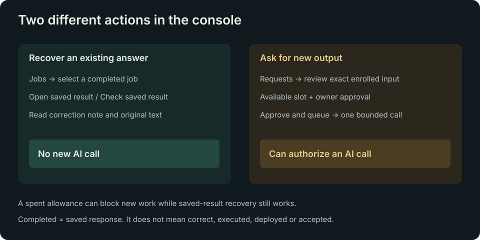

# Owner console guide

The authenticated console has five views when finite admission is enabled. A host without that feature has four views and no Requests submission controls.

The [cockpit tour](COCKPIT-TOUR.md) includes a 15-second recording and a quick
control guide. Navigation is centered horizontally. Open the **…** menu beside
Refresh for **Documentation ↗**, **Stealth mode**, motion controls and Sign out.
Documentation opens the guide index in a new tab and is available on the sign-in
screen.

Choose **Stealth mode** or press **Alt+Shift+S** for a plain Work Console with a
neutral title, sidebar on desktop, and motion turned off. Use the same control
to return to Picard. The cockpit HUD shows the shortcut.

Under **… → Auto stealth**, choose when the tab is hidden, after five minutes
without a click, keystroke or scroll, or both. Auto stealth starts off. Your
browser remembers the setting. Automatic entry stays on until you toggle it or
reload. The same job and request data remain visible.

| View | What to use it for |
| --- | --- |
| Overview | Check service reachability, provider/new-work availability, result recovery, scoped job counts and recent activity. Read the blocking reason and observation age. |
| Jobs | Inspect recorded jobs. In v1, choose a named row and Open request for progress/results across the configured owner; legacy hosts retain finite-catalogue result selection. |
| Requests | In v1, create an ordinary brief, review exact input/limits, approve one call, recover/export its answer and record a local review. Legacy hosts show the finite picker. |
| Groq | Watch current provider availability, relay outcome totals, recent activity and observation time. Request limits and safeguards are collapsed below the live data. |
| System | Inspect readable version, sequence, source commit, physical release fingerprint and dated updater activity. |

## Suggest a feature or report a bug

Open **… → Feedback** and choose a type. In cockpit mode, right-click an
exposed part of the starfield to start a bug report. The menu works with a
keyboard or touch.

Enter a title and details, choose **Preview**, then **Copy draft**. Open the
GitHub issue form and paste the first line as the title and the rest as the
description. GitHub issues are public. The preview contains only your typed
text and the feedback type. Closing it clears the draft.

## Earn Kills and Captures

**Kills** recognize confirmed bug reports and merged bug fixes. **Captures**
recognize accepted feature requests. Earned counts appear beside the rank in
the signed-in console, including in cockpit mode. Recognition is separate
from rank progress.

For maintainers and self-hosted operators:

1. Apply `picard:kill` to a confirmed bug issue or a merged bug-fix PR. Apply
   `picard:capture` to an accepted feature issue. Credit goes to the GitHub
   author. Award one label per item and choose one record for the same
   contribution when a report and fix share an author.
2. Set `BRIDGE_CONTRIBUTION_GITHUB_LOGIN` to the credited GitHub username in
   the relay's administrator-managed environment, then restart the relay once.
   This enables automatic recognition for that account.
3. On the next signed-in status read, the relay checks the two labels in the
   public Picard Relay repository. It checks at most once every ten minutes
   while the console is in use. The existing console refresh picks up the
   result. Adding or removing a label updates the counts after a complete
   check. Empty credits hide the distinction.

Automatic recognition uses two bounded public HTTPS reads to `api.github.com`
per check. The owner status response contains only the display counts. A failed
check preserves the last verified counts in memory. After a restart, the first
complete check supplies the counts again.

For manual recognition, leave `BRIDGE_CONTRIBUTION_GITHUB_LOGIN` unset and run
`node scripts/contributor-recognition.mjs <github-username>` with GitHub CLI
from a checkout. Set `BRIDGE_CONTRIBUTION_CREDITS` to the resulting JSON and
restart the relay to apply it. A configured GitHub login takes precedence.

## Legacy finite picker: new work versus recovery

Reading status, browsing job metadata, refreshing and checking a saved result do not make an AI call. Approve and queue can register one exact available request for a bounded provider invocation. It is disabled for spent or unavailable authority.

In Requests, distinguish the input label/source, full exact input, input hash and request slot. Two requests can have the same task title and still be different inputs. A real unavailability reason remains visible while a saved result is recovered. A fully spent, otherwise healthy console catalogue has no prominent slot warning; saved results remain readable and approval stays disabled.

The UI shows the recorded state, formatted inert code/tables and an expandable Original saved text. Completed means a reply was saved; review its contents independently. The narrowly bound Reviewed correction note identifies a known equality-case problem in one historical regression proposal, links to the reviewed cases, and preserves the original response. Other proposals are not automatically reviewed.

## Live data and scope

Status refreshes every 15 seconds while the owner is signed in and the tab is visible. These are read-only status/history requests, never provider calls. Refresh remains available; hidden tabs pause polling and resume on return. Failed reads retain the previous observation and mark current health/availability unknown.

When reusable Board admission is already enabled, Overview and Jobs show the configured owner's relay jobs across approved tasks. They no longer use the old console-catalogue task as an accidental filter. Other owners remain excluded. A host without that separately enabled feature retains its configured task scope, and the UI labels its scope.

Overview includes failed jobs; Running combines claimed and invoking jobs. Groq uses the same current counts/history. These are relay records and availability observations, not a live Groq billing/quota API. No inferred remaining quota is displayed.

## Learn the workflow and earn ranks

On Overview, **Your progress** opens the first-request walkthrough until you
review a saved answer. Choose **Create request → A checklist** to turn your own
notes into a practical first result. Edit the brief, review the exact input,
and approve one call when ready. Read the saved answer and accept it or request
changes to complete the walkthrough.

**Rank guide** lists the requirements and unlocks. To see the walkthrough again,
open **… (Settings) → Replay walkthrough**. Replaying opens Progress and keeps
any current draft.

The console keeps the spinning insignia, rolling counters and charcoal/brass colors. Your progress shows the next useful action. The brass insignia has shallow 3D edges and a recessed center; Ensign adds polish and Lieutenant adds brighter facets. Two inline SVG faces and five fixed edge planes share one CSS rotation. No images, rendering loop, new timers or libraries are loaded. Pause motion, reduced motion and hidden tabs still stop the spin.

| Rank | Earn it by | Interface tools |
| --- | --- | --- |
| Cadet | Sign in | Inspect setup, history, saved answers and diagnostics. |
| Ensign | Finish owner authentication, durable storage and provider enrollment; previous saved work also counts | Compose a first request, approve its exact limits, read/copy/download its answer and record a review. |
| Lieutenant | Complete and review one saved result; either Accept or Request changes counts | Add context/task links, use code/review templates, and export individual code files or a JSON handoff. |

Existing owned results/reviews count immediately. Reviewing an old answer can complete training without another provider call. The interface unlocks teach the workflow; the authenticated owner API and all exact-input/cost/invocation checks retain their existing authority. Ranks never increase limits, validate answer quality, authorize execution or claim current provider availability. Status, recovery and basic answer exports stay accessible during training.

Progress comes from the existing durable ledger and output-bound reviews, with no new schema or tracking store. A single indexed review lookup augments the existing workspace configuration response. The console reads it once on sign-in and coalesces concurrent loads; subsequent refreshes reuse the existing Requests polling. Unverifiable/stale progress earns no new rank or unlock. Previously verified achievements remain for the authenticated page session without extra polling; live readiness and exact-call approval still require fresh observations. Authentication loss clears rank details and logo decorations.

Progress leads Overview, above live readiness. Jobs, Groq and System offer the
next useful action: setup, an unfinished draft/request, result review or new
work. Continuing a draft preserves it. The raised horizontal control rail keeps
a stable shape, lights the active number and uses static shading and recessed
dividers. Sign-in has a brief fade; pause/reduced motion disable transitions.
The Refresh button includes a compact live/paused/stale/offline indicator;
hover/accessibility text includes the full cadence or failure explanation.
Scope and privacy details are in the small information disclosure. There are
no new libraries, external assets or timers. The walkthrough records v1.0.33;
the latest recorded enrolled-host checks cover v1.0.34. Other installations and
owner acceptance remain separate.

Activate the insignia five times to switch between the standard console and
the optional space cockpit. Consecutive clicks/Enter/Space activations must be
no more than five seconds apart; another five switch it off. Two SVG planes
move 128 round stars slowly behind the HUD. Navigation opens an opaque lower
reading deck while readiness and projected activity remain visible above it.
Click exposed space, choose Minimize panel or press Escape to retract the deck
without clearing the draft or selected result. Clicks inside the deck preserve
it. Pause motion and hidden tabs pause animation; reduced motion leaves a static
scene. Cockpit/stars reset on reload. See [Owner features](OWNER-FEATURES.md) for
earned ranks beyond Lieutenant and implementation details. Current releases
also project whole-VM CPU, reveal memory details on selection and support
restrained background-only look-around. See [Flight instruments](FLIGHT-INSTRUMENTS.md).

## Navigation and history

Views use hash routes; selected jobs/results use `#jobs/<ref>` and `#requests/<ref>`. Reload and successful sign-in preserve the intended destination. If browser history restores a loaded selected job that the retained filter would hide, Show changes to All loaded jobs so the job remains inspectable. Explicitly choosing a filter clears selection normally.

Jobs filters apply to loaded rows only. Paging is manual and capped at 100 loaded rows. Automatic history refresh updates the latest page; loading more than 25 rows retains those older pages and their recorded observation time until Refresh jobs is used. Live status totals continue to refresh. The legacy finite picker may not include every job in metadata history. V1 owner result recovery is independent of that catalogue. A different result is never substituted.

## Time, failure and privacy

Times include date/timezone. Observations refresh automatically while visible and can also be refreshed manually. Status older than a minute becomes unknown/stale; updater activity older than three minutes becomes unknown. Up to five seconds of future skew is tolerated as zero age, while a materially future timestamp remains unknown.

A failed refresh can retain the last actual values but must label current health/availability unknown. Saved responses survive allowance exhaustion; new-work readiness and result recovery are separate.

Logout, authentication loss and pagehide clear private inputs/results, selections, counters and accessibility labels. There is one active owner session, with an eight-hour absolute lifetime. Another login can replace it. No browser local/session storage holds tokens.

The insignia and counter animations are bounded and pausable, respect reduced motion and stop when the page is hidden. Mechanical Overview counters roll only changed Overview digits upward or downward for an actual observed change. Initial, unchanged and unknown values stay static; assistive tools receive the exact target immediately. A newer observation cancels an unfinished roll, and authentication clearing removes every old glyph. The v0.1.25 installed-host verification is recorded in [Status](STATUS.md). On narrow screens the input/result disclosures and normal page flow reduce nested scrolling. The complete live workflow should be checked at desktop, 390px and 320px widths after UI changes.

See [Quickstart](QUICKSTART.md), [limitations](LIMITATIONS.md), [API](API.md) and [known work](WORK-REGISTER.md). The synthetic console preview is useful for layout/regression tests; it does not prove live authentication, TLS or provider behavior.

## V1 request-to-result workspace

With explicit workspace activation, Requests uses a normal composer instead of the finite input picker. See [V1](V1.md) for the exact workflow. Prepared drafts are durable and have opaque links, but do not enter the queue until the signed-in owner approves the exact saved text and limits. Changing a brief prepares a separate draft; a spent, expired or uncertain job is never renewed by editing or refreshing it.

The workspace can recover valid results for the configured owner across tasks, independent of the current finite catalogue. Job names are shown in the owner workspace history. Draft and result text stays private; sign-out clears the form, rendered answer, review notes, pending reads and generated download URLs.

The original generated body and result SHA-256 remain unchanged. Review history is append-only with revision checks. Picard reviews are local assessments, not task-board acceptance or messages to another system. Exported Markdown, individual fenced code blocks and JSON handoffs are inert files. Measured usage and billed cost are explicitly unknown.

## Updates, earned work and the cockpit

The [owner-feature guide](OWNER-FEATURES.md) describes the update-check button,
owner-scoped accepted-work ranks, hidden locked controls and optional space
window. The updater bridge needs separate host enrollment. The [visual tour](COCKPIT-TOUR.md)
shows the recorded v1.0.33 interface; [Status](STATUS.md) records later v1.0.34
checks separately.
