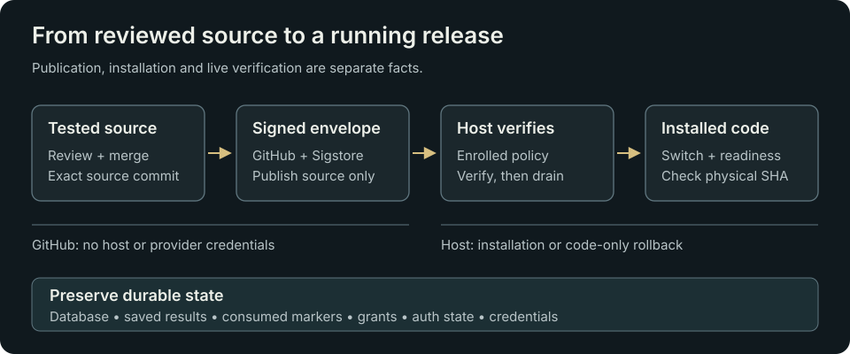

# Operations and release runbook

This guide is for an already authorized Linux host operator. Repository templates are disabled examples, not an installer or a reusable credential bundle. A host can be enrolled and working even while the public repository retains `experimental/` directory names.

## Installation boundary

The runtime needs Node.js 24, persistent SQLite storage, a dedicated unprivileged account, root-controlled code/configuration and a trusted HTTPS proxy. The listener binds to `127.0.0.1`; the proxy exposes the explicitly supported routes. Keep certificate verification and SELinux enforcement enabled. See [manual host setup](DEPLOYMENT.md) and [console authentication setup](self-hosted-console.md) for their narrower details.

The signed-runtime source is `experimental/runtime-control/src/`. The root `npm start` entrypoint uses the separate top-level preview tree. Do not point a host at one tree while assuming it runs the other.

| Configuration | Purpose |
| --- | --- |
| `BRIDGE_ENABLED`, `BRIDGE_PORT` | Explicit service activation and loopback port; default port 8787. |
| `BRIDGE_OWNER_ID`, `BRIDGE_ALLOWED_TASK_ID`, `BRIDGE_ASSISTANT_ID` | Exact server scope. |
| `BRIDGE_KEY_ID`, `BRIDGE_HMAC_SECRET_FILE` | Signed consuming-client transport. Keep secret material in protected files. |
| `BRIDGE_DB_PATH`, `BRIDGE_STOP_PATH` | Durable ledger and operator stop evidence. Production storage cannot be `:memory:`. |
| `BRIDGE_CONTROL_SOCKET`, `BRIDGE_RELEASE_HASH` | Private control socket and expected physical release identity. |
| `BRIDGE_CONSOLE_ENABLED`, `BRIDGE_CONSOLE_AUTH_DIR`, `BRIDGE_CONSOLE_ORIGINS` | Optional owner console; private auth state and exact HTTPS origins. |
| `GROQ_ENABLED`, `GROQ_ONE_SHOT`, `GROQ_API_KEY_FILE`, `GROQ_FREE_GATE_FILE`, `GROQ_ONCE_MARKER_FILE` | Explicit provider/gate/marker binding. A key alone cannot authorize work. |
| `GROQ_KEY_EXPIRY_FILE` | Optional, private operator record for the current admission key's documented expiry. Console display only. |
| `BRIDGE_ADMISSION_ENABLED`, `BRIDGE_ADMISSION_CATALOGUE_FILE` | Optional finite catalogue admission. |
| `BRIDGE_ADMISSION_LEGACY_BASELINE_FILE`, `BRIDGE_ADMISSION_LEGACY_BASELINE_SHA256` | Bound historical evidence needed for admission qualification. |
| `BRIDGE_ADMISSION_SIGNED_BRIDGE_ENABLED` | Separate opt-in for the reviewed signed-client admission path. |
| `BRIDGE_ADMISSION_REUSABLE_BOARD_ENABLED` | Separate existing opt-in for exact approved signed Board work across the configured owner's tasks; the console observes that owner-wide scope when admission is also enabled. This UI change does not activate it. |

Use the validators in `loadOracleConfig` and `prepareAdmissionRuntime` for complete requirements. Do not print a production environment file when checking one setting: it may contain sensitive values or paths. `deploy/relay.env.example` describes the disabled preview entrypoint and is not a complete finite-admission host configuration.

## State that must survive an update

Preserve the SQLite ledger and its consistent backup, invocation/consumption markers, cost uncertainty latches, approval/catalogue state, auth state, credentials, operator stop/hold evidence and updater transaction journal. Make a SQLite-consistent backup through an approved backup procedure; copying an active database without its WAL consistency is insufficient.

Runtime source replacement does not migrate or roll back these records. Restoring old state can make an already invoked request appear new. Never clear markers, recreate grants or overwrite a database to make a deployment look healthy.

## Understand the release pipeline



1. Review and test source on a branch. Changes to the signed runtime require the full updater/runtime suites and Unix-socket check described in [Development](DEVELOPMENT.md).
2. Merge the intended source into `main`. The signing workflow tests it on Node 24.22.1, builds the complete allowed source bundle and signs the manifest with Sigstore's ephemeral GitHub identity.
3. The workflow publishes `releases/stable.json` through a separate commit. It does not SSH, restart a host or receive host/provider credentials.
4. A separately enrolled host may download that envelope on its timer. The unprivileged fetch service writes an untrusted inbox file. The privileged updater has no IP networking and verifies source/signature/policy before installation.
5. The updater drains the fixed local service, confirms it can stop, journals the transaction, switches the immutable source release and checks readiness. Failed candidate readiness triggers code-only rollback. It does not make a provider call to test health.

Publishing source is therefore distinct from installing it, but an enabled host timer can consume a newly published valid release. Treat merging a runtime release with that enrolled schedule in mind.

V1 manifests use version `1.0.<workflow run number>` (older releases used `0.1.<run>`) and sequence is `run number * 1000 + attempt`. The release directory name is the SHA-256 of the raw manifest bytes. The manifest `sourceCommit` identifies tested runtime source; it can differ from the later publication commit at the tip of `main`. The current bundle contains exactly the 20 paths in `experimental/updater/policy.example.json`.

## Verify a deployment

Before installation, record the physical current release, service/recovery readiness, busy/draining state, unresolved invocations, ledger state counts and hashes of configuration and historical invocation markers. Check for STOP, HOLD, pending cost uncertainty and transaction journal evidence. A stop is evidence to investigate, not a file to remove automatically.

For an already enrolled host whose source update is authorized, the existing installer can be invoked with:

```sh
sudo systemctl start picard-updater.service
```

This is an installation action. The service depends on the existing fetch unit. Do not use it to bootstrap a new host, select arbitrary source or widen permissions.

Afterwards, independently verify:

- Current physical release hash, manifest version/sequence/source commit and exact source-file hashes match the intended signed envelope.
- Service and result recovery are ready; no unexpected busy/draining or unresolved-invocation state exists. Provider readiness may intentionally be false when allowances are spent.
- Configuration, historical markers and ledger counts are preserved unless an independently authorized request explains a change.
- Authenticated System, Jobs and Requests work through real HTTPS. Reproduce the changed behavior at desktop and narrow widths.
- Reconcile console counts and loaded job references/states with the matching configured owner/task ledger query. Check scope and automatic observation updates; host-global health totals can include a different scope.
- The updater reports its actual last attempt/outcome. A successful check can mean no newer release was installed.

Record code tested, source merged, envelope published, host installed, live behavior verified and owner acceptance separately.

The public source feed may briefly serve a cached previous envelope after GitHub publishes a new one. A successful `no_new_release` check confirms no newer envelope was installed from that observation. Let the feed refresh and compare the intended manifest/source identity; do not bypass signature, sequence or state-preservation checks to force an installation.

## Routine read-only checks

On the conventional enrolled host, inspect fixed unit metadata:

```sh
systemctl show board-event-relay.service --property=ActiveState,SubState,MainPID,Result
systemctl show picard-updater.service --property=ActiveState,SubState,Result,ExecMainStatus
systemctl show picard-updater.timer --property=ActiveState,SubState
systemctl show picard-updater-activity.timer --property=ActiveState,SubState
```

Names and layout are fixed by the enrolled host support code. The activity observer writes only bounded typed metadata at `/var/lib/picard-updater-status/status.json`. It reads policy/HOLD presence and fixed systemd metadata; it neither installs releases nor exposes raw logs. Its one-minute timer is separate from the updater's five-minute schedule with randomized delay.

## Troubleshooting

| Symptom | Check / next action |
| --- | --- |
| Relay reachable, new work blocked | Read the typed reason in Overview/Groq. Recover saved results. Spent or unavailable allowance does not mean the service is down. |
| Request expired or no enrolled slot | Enroll appropriate new work through the existing operator process and obtain fresh exact owner approval. Do not reuse a spent slot. |
| Uncertain or incomplete result | Preserve the original request, markers and receipt. Incomplete/failed remains spent; uncertain work needs operator review and no automatic replay. |
| Stale/unknown observation | Refresh. Inspect host clock and the status/observer read path if the warning remains. A material future time must not be presented as current success. |
| Login fails / rate limit | Check the one-session policy, 8-hour expiry, HTTPS origin/cookies, private auth-state permissions and the five-attempt/minute budget. Do not reinitialize enrolled state. |
| Updater unknown | Check observer timer, status-file ownership/size/age and precise SELinux denials. Do not disable enforcement or grant broad secret access. |
| Updater held or journal present | Preserve the checkpoint and diagnose its typed code/transaction phase. No blind hold/journal deletion or forced restart. |
| New version missing | Check workflow source SHA and publication separately from fetch, verification and installation. A green workflow alone does not establish the host version. |
| Job outside current catalogue | V1 recovers validated results across the configured owner through the workspace. Legacy picker hosts retain the catalogue restriction. Do not substitute another result. |

## Replace a Groq key

The signed-in **Groq → Groq key** row warns during the last seven days when the
operator has recorded a documented expiry for the active key. If the provider
does not give you a date, leave it unknown. An approval deadline, a finite
catalogue deadline and the date Picard verified Free-plan evidence each have a
different meaning.

1. In the intended [Groq project](https://console.groq.com/keys), obtain the
   replacement key and verify that the project is still on Free. Keep the key
   in the operator's protected credential file.
2. Prepare the key, its matching retained Free enrollment and the catalogue
   bound to that enrollment in separate protected files. Use the established
   host enrollment procedure and preserve the legacy baseline. Review the exact
   binding, then drain and restart with the matching set. Keep the previous
   configuration available for code/configuration recovery while it is valid.
3. Check new-work readiness and open a saved historical result through the
   signed-in console. Confirm the ledger, consumed markers and uncertainty
   evidence are intact. A later provider request needs its own approval and
   allowance.

If a pending reservation blocks new work, preserve it and review its original
job and enrollment evidence before attempting replacement. Replacing a key
does not resolve an earlier reservation.

If Groq gives an actual expiry, set `GROQ_KEY_EXPIRY_FILE` to an absolute path
that the service can read under the existing private-file rules. The JSON must
contain exactly `v` (1), `keySha256` (SHA-256 of the trimmed key, matching the
existing Free enrollment) and `expiresAt` (canonical UTC ISO timestamp including
milliseconds). The relay reads the record at startup. Missing, invalid or
mismatched data displays **Expiry unknown**. The owner status response contains
only the date. The console links to this procedure and credential changes take
place through the operator-managed host configuration.

## Rollback and recovery

Automatic transaction rollback restores code only when a candidate fails readiness. For manual recovery, retain the journal, original/current release identity and failure evidence first. Determine the recorded phase and use the reviewed recovery path for that installed updater. Do not improvise a symlink switch during an incomplete transaction.

The monotonic release sequence rejects ordinary downgrades. A reviewed forward release containing a prior known-good source can be preferable to bypassing that check. Never restore a ledger, rotate credentials, alter proxy/firewall/SELinux policy or renew a request as an incidental code rollback. Actual power-loss/disk-full recovery remains a separate qualification limit.

## V1 activation and backup rehearsal

Review the disabled [workspace configuration fragment](../deploy/workspace.env.example) and [explicit proxy-route template](../deploy/Caddyfile.workspace.example). These are preparation artifacts; validate and adapt them to the actual enrolled proxy before activation.

Set **BRIDGE_WORKSPACE_ENABLED=true** only on an already enrolled host with console, admission, signed-bridge admission and reusable-Board admission enabled. This explicitly gives the existing authenticated owner permission to approve new bounded text requests without per-input operator catalogue edits. The default is disabled. New public proxy paths must retain the same HTTPS, origin and authentication boundary; expose only the exact workspace routes in [API](API.md). No host setting or proxy rule changes merely because source is merged.

The installed bundle still contains the same 20 allowed modules and requires no schema migration. Drafts, reference aliases and append-only reviews use a separate durable namespace in the existing ledger metadata. Never delete those records to make a spent request appear new. Disabling the workspace stops new console admission; preserve its records and use an intentionally qualified recovery configuration for pending jobs.

For a SQLite-consistent ledger snapshot, use Node 24 and the operator's protected paths:

```sh
node scripts/backup-ledger.mjs --database /absolute/ledger.sqlite --output /absolute/new-private-backup-directory
```

The utility refuses an existing output directory, uses SQLite's online backup API, verifies database integrity and writes a bounded manifest with a SHA-256, state counts and exclusions. It never prints request content or copies credentials. It is outside the signed runtime bundle and is an operator tool. See the official [Node 24 SQLite backup API](https://nodejs.org/download/release/latest-v24.x/docs/api/sqlite.html#sqlitebackupsourceDb-path-options).

This is a ledger backup, not a complete host recovery image. For a complete checkpoint, drain the service, let active work settle, stop it, and preserve the matching invocation markers, cost latches, auth state, configuration, credentials and updater evidence through the operator's protected backup procedure. Restart only after the checkpoint is consistent. Never restore an older ledger beside newer markers or overwrite a running database.

Rehearse recovery into a new isolated directory first. Compare the manifest hash, run PRAGMA integrity_check, inspect original result/review identities, and prove that reading the restored completed request makes no new call. The automated fixture does this without production secrets. Actual host restore, power-loss and disk-full qualification remain separate operator work.
