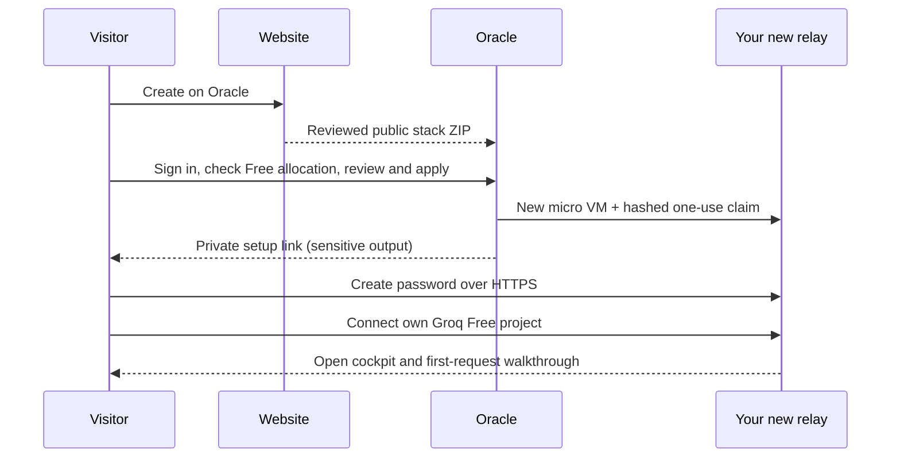

# Create your relay on Oracle

This launch candidate takes you from Picard's website to a separate Oracle VM,
then into your own relay to create a password and connect Groq. It does not
replace an existing relay. It uses an official Oracle Linux platform image,
not a prebuilt Picard machine image.

## Your setup path

1. On the [website](https://bmartynowicz.github.io/picard-relay/), choose **Set up
   my relay → Create on Oracle**. Oracle handles sign-in. New users must first
   create their own eligible Oracle account; Picard does not do that for them.
2. In Oracle Resource Manager, use Terraform **1.5**, your **home region**, a
   compartment you control, and an availability domain with a Free micro slot.
   Read and check the Free allocation confirmation. An SSH **public** key is
   optional for later operator recovery; never enter a private key.
3. Review the plan before **Apply**. It must contain one
   **VM.Standard.E2.1.Micro**, one **50 GB Balanced boot disk**, and a new
   network exposing **HTTPS 443 only**. There is no paid shape selection or
   fallback. The stack inventories existing instances and boot/block disks
   throughout the tenancy. Missing read access, unknown limits, a full
   allocation, or a different region stop it. Do not create other resources
   concurrently. Out-of-capacity is a stop, not an instruction to upgrade.
4. When Apply finishes, open the job's **Application information** tab. Unlock
   **Create your password** and open that private link. The VM may need several
   minutes to finish first boot and obtain HTTPS. Keep using that same link;
   do not create another stack because the page is not ready yet.
5. Create a unique owner password on **your new relay**. The one-use claim
   expires one hour after first-run installation. It disappears from the
   address bar immediately. Do not share it or paste it into the public website.
6. In [Groq Console](https://console.groq.com/), verify your project is **Free**.
   Enter its API key, organization ID, project ID and a short name on your own
   relay's **Connect Groq** page. Confirm that the key belongs to this Free
   project. No password or Groq key goes to the marketing website or Terraform.
7. Picard opens your cockpit. Follow the walkthrough to approve one useful
   request. Connecting the key itself makes **no model call** and does not prove
   that Groq will accept it. The first approved request establishes that.

## What stays private

Oracle's private Terraform state contains the short-lived claim code. Sensitive
outputs hide it from ordinary output; they do **not** remove it from state.
Restrict who can read Resource Manager jobs/state. The VM receives only the
claim's SHA-256 hash. Your password is stored as an existing scrypt verifier;
your Groq key goes to a private credential file on that VM. Neither is placed in
Terraform, instance metadata, the marketing website, or browser storage.

Password creation retains Picard's existing secure cookie, five-attempt sign-in
limit and one active owner session. Connecting Groq requires a sign-in less
than five minutes old. A lost submit response leads to read-only progress
checks with the same request identity, not a second connection attempt.

## Free allocation and availability

The fixed resources target Oracle's current Always Free E2 micro allowance:
up to two micro instances in the home region and 200 GB combined boot/block
storage. The launch reserves 50 GB by checking that the existing inventory plus
this disk fits. It reads the selected domain's remaining micro availability.
Inventory is bounded to small tenancies (fewer than 64 child compartments).
API denial or an incomplete observation stops the plan.

These checks and your account confirmation are not an atomic billing lock or
a live billing guarantee. Other concurrent provisioning, a paid/upgraded
account, changed provider rules, bandwidth/storage use and optional account
services remain your responsibility. There is no automatic refill, capacity
retry on another shape, account upgrade, paid add-on, or paid fallback. Oracle
may have no Free capacity or reclaim idle Free machines.

Oracle Resource Manager has no separate service charge; the resources it
creates follow Oracle's pricing. See Oracle's [Always Free allocation](https://docs.oracle.com/en-us/iaas/Content/FreeTier/freetier_topic-Always_Free_Resources.htm),
[Resource Manager FAQ](https://www.oracle.com/uk/cloud/cloud-native/resource-manager/faq/),
[deployment-button contract](https://docs.oracle.com/en-us/iaas/Content/ResourceManager/Tasks/deploybutton.htm),
and [state access controls](https://docs.oracle.com/en-us/iaas/Content/Security/Reference/resourcemanager_security.htm).

## Host behavior and recovery

The first boot downloads a content-addressed host package and verifies its
SHA-256, then uses the existing pinned Node/Caddy installer and signed-runtime
verification. Runtime source must match the currently signed publication or
installation stops. A newer runtime publication can therefore require a new
website bundle; publishing an old bundle is not a supported install path.

First-run uses one temporary unprivileged loopback service and one fixed root
activation helper. The helper checks the recent owner session independently,
consumes one connection request, preserves owner auth and HMAC, and enrolls the
normal Update/Replace key helpers. On success, the temporary service/path are
disabled. Only the normal relay and HTTPS service remain continuously running;
maintenance uses the existing timers and on-demand helpers. No new database,
framework, Docker service, or cloud credential is required on the VM.

Partial setup stops without deleting or resetting the password, configuration,
claim evidence or state. Do not rerun setup or destroy the stack as a repair.
An operator can inspect `cloud-init status --long`,
`journalctl -u picard-first-run-activate.service`, and the root-only
`/var/lib/picard-first-run/activation.json`. Do not paste private files or raw
credentials into support messages. The first-run service and public status page
do not expose the key. A failed/uncertain initial connection is never replayed.

SSH ingress is closed. If you supplied a recovery public key, an operator must
explicitly add a narrow SSH rule before using it, or use Oracle's own recovery
tools. The stack prevents accidental instance destruction and preserves its
boot disk. Deliberate removal needs a reviewed cleanup plan, including retained
disk/storage accounting; it never authorizes deletion of another relay.

## Build and verify

`node scripts/build-oracle-launch.mjs EMPTY_OUTPUT_DIR` creates a Terraform ZIP
and one content-addressed host archive using explicit file allowlists. The
landing builder includes these as downloads; visiting the page downloads neither.
Oracle's launch link uses the ZIP attached to a GitHub release, a supported
deployment-button source. A Pages-hosted ZIP alone produces Oracle's
`GetPackage InvalidParameter(400)` error. The release tag is
`oracle-launch-` plus the first 16 hex characters of the ZIP's SHA-256. Before
publishing the website, attach that exact ZIP as `oracle-stack.zip` to that
immutable release; never overwrite an existing release with different bytes.
The unbuilt repository has `UNPUBLISHED` artifact constants and refuses resource
creation. Publish the website and its matching packages together after review.

Portable tests: `npm run test:setup` and `npm run test:landing`. The dedicated
public CI checks actual Terraform 1.5.7 validation and refusal plans without
cloud API calls. Disposable Linux first-run qualification uses verified local
HTTPS and synthetic keys, then exercises Update, Replace key, an old saved
answer, and new synthetic work. Native Oracle qualification uses an official
Oracle Linux image with 1 GB RAM and SELinux enforcing.

Those fixtures do **not** establish actual OCI Resource Manager provisioning,
public DNS/ACME issuance, or acceptance of a real Groq key. Keep their receipts
separate from a real owner-approved cloud launch. No new public launch has been
performed as part of building this candidate; the working owner relay is not
a fresh-setup test target.
