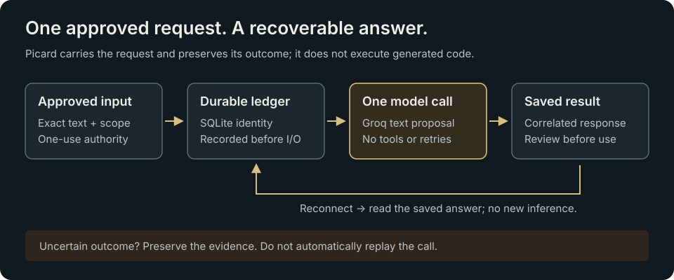
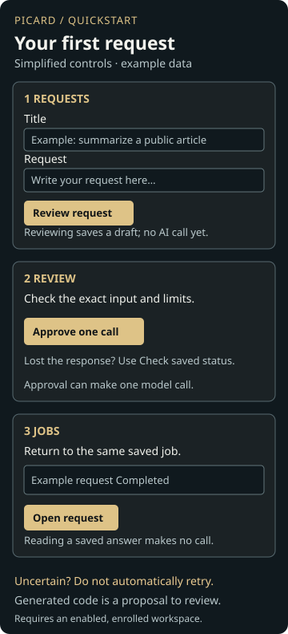

# What Picard does and how to use it

Picard is a small, self-hosted delivery layer for bounded AI requests. It solves the handoff between an approved task, an external model call and a durable saved answer. Its important property is that losing a connection or restarting the service does not silently authorize another model call.

It is useful when you need a small operational console, strict request boundaries and recoverable results on modest hardware. The v1 source provides bounded text requests and recoverable results. It does not provide an autonomous coding agent, a complete task board or a general model marketplace.



The ledger records request identity before the model call. Reconnecting reads the correlated saved answer; an uncertain outcome stops rather than authorizing a replay.

## Try the offline demo

Install Node.js 24 and Git. The CI runtime is Node 24.22.1. There are no npm package dependencies to install. OpenSSL is needed for the local TLS test when running the full test suite.

```sh
git clone https://github.com/bmartynowicz/picard-relay.git
cd picard-relay
npm run demo
```

Expected ending:

```text
One synthetic request, one stored answer, duplicate replay suppressed.
No network, API key, billing, deployment, or live AI invocation.
```

The demo does not start the web console. To try the synthetic request workspace instead, run:

```sh
npm run preview:v1
```

Open the printed loopback address on the same computer; press Ctrl+C in the terminal to stop the preview. This preview uses disposable fixture data and does not call an AI provider. It is not a production installation.

`npm start` is disabled without explicit configuration. For the full test commands and source layout, see [Development](DEVELOPMENT.md). For a real installation, see [Operations](OPERATIONS.md); there is no one-command production installer.

## Use the V1 owner workspace on an enrolled host



When enabled, sign in to the supplied HTTPS console. In **Requests**, enter a title and input, select **Review request**, check the details, then **Approve one call**. A draft alone makes no model call. In **Jobs**, **Open request** recovers progress and saved results.

Copy or download the answer, code or handoff; record a separate review when ready. See the illustrated [V1 guide](V1.md). Hosts without the workspace enabled use the legacy picker below.

## Use an enrolled host with the legacy finite picker

1. Open the HTTPS console address supplied by its operator and sign in. Picard permits one active owner session; another login can replace it.
2. Read **Overview**. A reachable relay can still be unable to accept new work. Check the explanation, observation time and result-recovery status.
3. For an existing job, open **Jobs**, choose a row and select **Open saved result** when available. **Requests** also lets you select an enrolled input and **Check saved result**. These reads do not call the model again.
4. For new work, review the exact enrolled input and request slot in **Requests**. **Approve and queue** is the action that can authorize one bounded model call. It is unavailable when that slot is spent, expired, blocked or not currently verified as available.
5. Treat the saved answer as untrusted proposal text. Check any review/correction note, inspect the original saved text, and review the content before using it elsewhere.

New arbitrary text cannot be typed into the legacy finite picker. The operator must enroll an appropriate finite catalogue and the owner must approve the exact request. A different request needs fresh authority; copying an old slot or clearing a consumed marker is not a supported shortcut.

## Read the outcomes correctly

- **Completed** means a response was durably saved. It does not mean generated code is correct, executed, merged, deployed or accepted by a person.
- **Failed / incomplete** is a recorded failed outcome. A spent request remains spent.
- **Uncertain** means the invocation may have happened without a dependable final receipt. Preserve the evidence and seek operator review. Do not retry it automatically.
- **Provider unavailable / no usable allowance** can coexist with healthy service and working saved-result recovery.

Continue with the [console guide](CONSOLE-WORKSPACE.md), [limitations](LIMITATIONS.md) and [known work](WORK-REGISTER.md).
