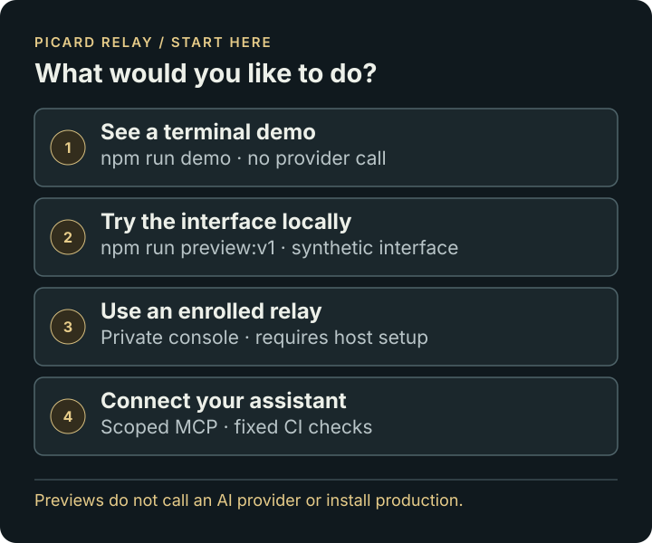

# Picard Relay documentation

Picard Relay accepts a narrowly approved AI request, records it durably, sends it to the configured provider once, and makes the saved answer available for later retrieval. It also provides an authenticated console for inspecting the relay. Generated answers are proposals for a person to review; Picard does not execute them.

## Find your path

**New to Picard?** [Quickstart](QUICKSTART.md) · [V1 workspace](V1.md) · [Console guide](CONSOLE-WORKSPACE.md)

**Building or operating?** [Architecture](ARCHITECTURE.md) · [API](API.md) · [Operations](OPERATIONS.md) · [Development](DEVELOPMENT.md) · [Coding-agent workflow](../experimental/compute-broker/CODING-WORKFLOW.md)

**Updating your relay?** [System update button and host connection](OWNER-UPDATES.md)

**Before relying on it:** [Limitations](LIMITATIONS.md) · [Known work](WORK-REGISTER.md) · [Verified status](STATUS.md)

**Experimental:** [Compute broker](../experimental/compute-broker/README.md) · [Provider research](../experimental/compute-broker/PROVIDERS.md) · [Execution enrollment](../experimental/compute-broker/EXECUTION.md)

**AI tools:** [llms.txt](../llms.txt) · [AGENTS.md](../AGENTS.md) · [Project map](project-map.json) · [Workspace contract](workspace-contract.json) · [Structured work register](work-register.json)

## Which information wins?

1. For behavior, inspect the relevant source and its tests at the commit you are using.
2. For installed state, inspect that host's authenticated System view and physical release identity. A repository branch or successful workflow does not prove installation.
3. Use this index and its linked guides for current documentation. The work register is a dated, sanitized snapshot of known work; the owner's private task board remains the operational record.
4. Older review/checkpoint documents preserve design history. Their original verification limits apply to their stated checkpoint, rather than all later releases.

The top-level `src/` offline preview and `experimental/runtime-control/src/` signed-runtime source are separate trees. Read [Development](DEVELOPMENT.md) before changing a file: changing the top-level preview alone does not update the signed console.
