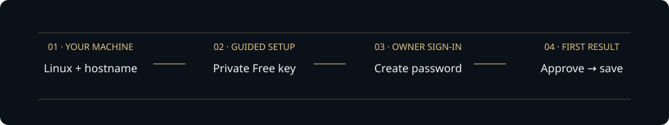

# Set up your Picard Relay

Run Picard on a Linux machine you already have. The guided setup installs the
signed runtime and HTTPS services, creates private storage, and connects your
Groq Free project. Update and Replace key are connected during installation.
Then you create your sign-in and send a useful first request.



## 1. Have these ready

- A **fresh Ubuntu 22.04/24.04 or Oracle Linux 9 machine**, x86-64 or ARM64,
  running systemd. You need terminal access with `sudo`, Git, curl, tar and xz.
  This path uses the machine you already own; it does not create a cloud account
  or machine. Check that your existing host and network are free to use.
- A **hostname pointing to that machine**. Your DNS provider's A record points
  to its public IPv4 address. If you publish an AAAA record, IPv6 must also reach
  this machine. Allow inbound **TCP 443** in its existing cloud and host
  firewall. Keep SSH restricted to your own addresses. The installer does not
  edit network rules or disable SELinux. FIPS hosts are refused; the bundled
  Node process uses its own OpenSSL defaults without changing the host policy.
  HTTP port 80 is optional for redirects and the HTTP certificate challenge;
  Caddy can issue certificates over port 443 using its default TLS-ALPN challenge.
  See [Caddy's challenge documentation](https://caddyserver.com/docs/automatic-https#tls-alpn-challenge).
- A **Groq Free project and a key from that same project**. In
  [Groq Console](https://console.groq.com/), check the project's plan, copy its
  organization/project IDs, and create or select its API key. Do not upgrade
  the plan or enable paid usage. Keep the key in your private terminal; never
  put it in chat, a command, a screenshot or a Git commit.

This is fresh-host setup. If Picard, a web server, or a previous setup attempt
already uses the target paths, users or ports, it stops. Use
[existing-host operations](OPERATIONS.md) for an existing relay.

## 2. Run guided setup

In the Linux machine's terminal:

```sh
git clone https://github.com/bmartynowicz/picard-relay.git
cd picard-relay
sudo bash scripts/setup-linux.sh
```

Use a reviewed checkout from this repository. The script downloads pinned
official Node.js 24.22.1 and Caddy 2.11.9 binaries, checks their SHA-256 hashes,
and verifies the official signing tool and the signed Picard release. Its runtime
must match the reviewed checkout exactly; a mismatch stops setup. Update your
checkout to the published source before trying again. It asks for your hostname
and Free-project details. **The key is hidden while you enter it.** Review the
destination, signed version and update schedule; type `install` to continue.

On SELinux hosts, setup persistently labels the two service executables using
the distribution's ordinary custom-service executable type. Oracle Linux may
need the standard labeling management tools, installed from its existing signed
OS repositories after you confirm installation. Enforcement and network booleans
stay unchanged. This uses the distribution's default custom-service domain;
it does not add a dedicated Picard SELinux confinement policy.

It creates the `board-event-relay` and `picard-relay-web` service users, the two
long-running services, and these directories:

| Location | Contains |
| --- | --- |
| `/usr/local/lib/board-event-relay` | Immutable signed releases, current release pointer, private Node/Caddy and proxy configuration |
| `/etc/board-event-relay` | Protected key, Free-project confirmation and admission policy |
| `/var/lib/board-event-relay` | Private owner sign-in, SQLite workspace, consumed-call markers and private control socket |
| `/var/lib/picard-relay-web` | HTTPS certificates and Caddy state |
| `/usr/local/lib/picard-updater`, `/etc/picard-updater` | Root-controlled updater, signing trust and fixed publication policy |
| `/var/lib/picard-updater*`, `/var/lib/picard-update-requests` | Update checkpoints, restricted download inbox, status and owner request queue |
| `/usr/local/lib/picard-groq-replacement`, `/var/lib/picard-groq-replacement` | Restricted key-replacement helper and status |

There is no npm install, container or extra browser library on the host. The
updater checks the fixed signed publication every five minutes; a small observer
refreshes update status each minute. Other helpers run only on demand. Setup
makes **no AI call**. A Free-plan confirmation is
recorded evidence from you, not a live billing guarantee.

## 3. Create your sign-in

Open the printed **HTTPS address**. In the terminal, read your private setup code:

```sh
sudo cat /etc/board-event-relay/first-sign-in.txt
```

Enter the code and choose your owner password in Picard. The code expires after
one hour and cannot create another owner after it has been used. Keep the code
private. When sign-in is complete you can remove only that note:

```sh
sudo rm -- /etc/board-event-relay/first-sign-in.txt
```

If the browser shows a certificate warning, stop and check the hostname/DNS and
TCP 443. Caddy obtains its certificate automatically over HTTPS; opening HTTP
port 80 is optional.
Never enter the key or owner password through an HTTP page or bypass a warning.

## 4. Save your first useful answer

Choose **New request**, paste a short rough note, and ask Picard to turn it into
a checklist. Review the exact brief and approve it yourself. Open the saved
answer, copy what is useful, and record your review. Follow the
[first-request walkthrough](QUICKSTART.md#run-your-first-useful-request) for a
ready-to-use example. **Rank guide** explains the unlocks; **Settings → Replay
walkthrough** brings the steps back later.

## Update or replace your key

In **System**, choose **Check for updates**. Picard checks the fixed signed source
and reports the result. The five-minute timer also checks automatically; only
valid newer runtime publications are eligible. Host support and Node stay outside
that runtime update. See [updates](OWNER-UPDATES.md) for cooldowns and held states.

In **Groq**, choose **Replace key**. Sign in again if asked, enter a key from the
same verified Free project and confirm the plan. The protected local helper
stages a new enrollment and briefly reconnects the relay. Saved answers, old
enrollments, consumed-call markers and uncertainty stops remain in place.
Replacement itself makes no model request; a working key still needs a separately
approved first request. Never put a key in chat or a GitHub issue.

## If setup stops

Setup preserves partial files and identities instead of deleting or replacing
them. A rerun refuses them. Do not wipe the database, markers, policy or owner
state to make the error disappear.

For a service problem, inspect `sudo systemctl status board-event-relay
picard-relay-web` and the corresponding journal privately. Share only a
sanitized error, never credential files or owner state. If startup fails after
this attempt starts services, it stops/disables its services, socket and timers;
partial installation stays
available for investigation. A public HTTPS check can remain pending after the
services start, usually requiring DNS/network diagnosis rather than reinstalling.

If the one-hour code expires before owner setup, the bootstrap must be reviewed
and renewed by an operator **only after confirming no owner was created**.
There is no automatic owner reset or destructive retry path.

## Qualification and limits

This is a **fresh-host setup candidate**, separate from the already deployed
relay. Its generated configuration is checked against the production validators.
The Linux fixture uses real ownership and file modes, runs as an unprivileged
service UID, and exercises first sign-in, exact approval, one synthetic answer
and saved-result recovery after restart.

The earlier source-only installer passed on a disposable Ubuntu 24.04 x86-64 VM
([recorded check](https://github.com/bmartynowicz/picard-relay/actions/runs/43307474518)).
That result does not qualify this signed setup extension. Its separate
[qualification PR](https://github.com/bmartynowicz/picard-relay/pull/141) includes a
[passing four-target check](https://github.com/bmartynowicz/picard-relay/actions/runs/43337985805)
of installer source `940b1246584ec87a8e92112165da68a4470da7d0`. It ran the
actual wizard, services and authenticated Update/Replace key endpoints on Ubuntu
24.04 x64/ARM64 VMs and Oracle Linux 9 x64/ARM64 systemd containers. It checks a
synthetic saved answer before and after replacement, then saves new synthetic
work under the new enrollment. All four passed; each retained its old answer and
saved a new synthetic answer after replacement, with two consumed markers and
zero external model calls. Update reported up to date against the same signed
release; this check did not apply a newer publication. Updater transaction and
rollback regressions are separate from that result.

The CI-only hostname uses a local CA explicitly trusted by that fixture client.
This does not qualify public DNS/ACME certificate issuance, a real Groq key,
native Oracle Cloud deployment or Ubuntu 22.04. Oracle containers are not
Oracle cloud machines. See the PR's exact source and results before relying on a
platform check; do not describe this as a universally qualified installer.

The signed extension enrolls the fixed host updater, the **Update** button and
the **Replace key** host socket. It starts with a verified immutable runtime and
release identity. Existing relay upgrades and migrations remain outside this
command: it refuses both the older `/opt/picard-relay` layout and existing
versioned installs, users, support directories, units and occupied ports. Use
[operations](OPERATIONS.md) for an existing host.

The [native Oracle qualification](https://github.com/bmartynowicz/picard-relay/pull/143)
adds an official checksum-pinned Oracle Linux 9.8 VM, its own Oracle kernel,
1 GB RAM and SELinux Enforcing. This exposed executables incorrectly retaining
the library file label, which left services in systemd's domain and blocked
the private socket and proxy connection. The candidate corrects persistent
executable labels and waits for private runtime health before reporting success.
Its test still uses a local CA and synthetic key; check the PR's exact source
and results separately from public HTTPS, real-key and OCI control-plane checks.

Implementation `5bd64b244e0eab0030387ec43fd22433b72f2149` passed the
[native Oracle fixture](https://github.com/bmartynowicz/picard-relay/actions/runs/43486575595)
and [four-target setup](https://github.com/bmartynowicz/picard-relay/actions/runs/43486575453).
Picard's [coordinator](https://github.com/bmartynowicz/picard-relay/actions/runs/43487084597)
and [protected worker](https://github.com/bmartynowicz/picard-relay/actions/runs/43487157562)
verified all seven repository groups and saved result recovery after restart.
This evidence uses synthetic requests and a local CA, not a live provider key.

Model work remains fixed to Groq `openai/gpt-oss-20b`, one exact approval per
call, at most 4096 output tokens, no model tools, retries, code execution or paid
fallback. Keep your host's own billing controls in place.
