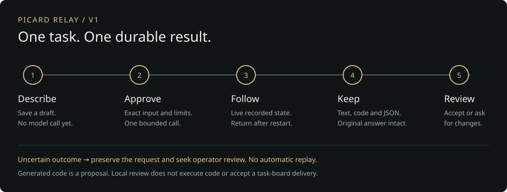

# Picard Relay v1

V1 takes an owner from an ordinary text request to a durable, reviewable answer using the configured Groq provider. Generated code stays a proposal. The console and signed task-board client share the durable dispatch and recovery boundary.

## Use the workspace

1. Open Requests and enter a title and the exact input. Add supporting context or an existing task ID if helpful.
2. Select Review request. This saves an inert draft with a stable link. Review the full input, provider, one-call ceiling, output limit and expiry.
3. Select Approve one call. Follow the persisted job state; you can leave and return to the same link. A status check is read-only.
4. Open the saved answer. Copy it, download the original Markdown, download a fenced code block, or export the JSON handoff with provenance and reviews.
5. Record Accept result or Request changes, optionally with a note. This assesses the answer without executing it, replacing it, calling the provider or accepting a Board task.

If a submission response is lost, select Check saved status. If the outcome is uncertain, preserve the request and seek operator review. To change an unapproved brief, select Edit brief and prepare a separate draft. New request starts a separate task. Expired drafts cannot run.

## Product and visual direction

The [cockpit tour](COCKPIT-TOUR.md) shows the current interface: horizontal
navigation, a spinning brass insignia, projected activity and reading decks that
expand over an optional moving starfield.

Requests is the primary workspace; a brief and exact approval lead to live job
details, saved output and a separate owner review. Jobs is the history; Groq
shows availability and activity; System shows health, updates and recovery.
Documentation, motion controls and Sign out are in the upper-right menu.

Interaction thesis: preserve the rolling activity counters, use a short review/result reveal, and make selection and pending actions immediately visible. Reduced motion and Pause motion suppress transitions. No decorative dashboard cards or marketing hero.

## Scope and acceptance

| Capability | Required behavior |
| --- | --- |
| Request creation | Title, task reference (optional), bounded exact input, optional context and a review/proposal purpose. Preparing a draft makes no provider call. |
| Approval | Show exact text/context, fixed provider/model, one call, 4,096 output-token ceiling, expiry, no tools/retries/fallback and the limits of retained Free enrollment. Approval is authenticated, same-origin, session-bound and single-use. |
| Durable identity | A client request ID resolves to one immutable draft and one job. Duplicate/concurrent submission and lost responses recover that identity. Edits create a separately reviewed draft. |
| Progress | Persisted queued, claimed, invoking, completed, failed, blocked, cancelled or uncertain states; explicit next action and freshness. Hidden tabs stop polling. |
| Results | Recover any valid result within the configured owner's scope, including old task-board work outside the finite catalogue. Render inert text/code, copy/download original output, download individual fenced code blocks and a provenance JSON handoff. |
| Review | Accept or request changes with a note; persist an append-only decision linked to the original output hash. Review never edits the generated answer, invokes the provider or marks a Board task accepted. |
| Operations | Read-only readiness checks, setup/configuration guide, consistent SQLite backup/restore rehearsal, resource measurements and restart qualification. Source updates preserve all existing state. |
| Documentation | Human guide, illustrated workflow, endpoint schemas, structured AI contract and explicit limitations/known work. |

## Release proof

Use a disposable, clearly marked fixture for normal and `--jitless` qualification. Submit an ordinary request through real owner authentication and the production handler, approve it, complete it through the real dispatcher/store boundary, restart and recover exactly the same saved result with one fixture invocation. A second interrupted invocation becomes uncertain and is never replayed. Exercise duplicate and concurrent clicks, response loss, changed input/session/owner, expiry, revocation, unavailable provider, review conflicts and hostile output.

Then verify desktop and narrow browser flows, keyboard focus, stale/error states, result downloads, sign-out clearing and motion preferences. Fixture evidence is distinct from a live provider call and installed deployment evidence.

## Activation and limits

The owner workspace is explicitly enabled with `BRIDGE_WORKSPACE_ENABLED=true` on an already enrolled admission/reusable-Board host. Enabling it gives the authenticated console owner authority to approve new bounded text requests without operator enrollment for every input. It does not grant that authority to an unauthenticated browser or to an HMAC client without its separate Board approval.

No new provider, account, billing upgrade, model selection, live quota/billing API, code execution, autonomous tool loop, multiuser roles or generic Board installation is included. Free enrollment remains retained evidence, not a live monetary guarantee. Existing historical uncertainty, markers, cost stops and update holds are preserved.

The private task board remains the operational backlog. The enrolled host was installed and explicitly activated on v1.0.26 / sequence 26002 on November 3, 2026 (November 4 UTC). One generic live Groq smoke request, exact downloads, persisted review and restart recovery passed while preserving historical state. See [Status](STATUS.md) for the exact release and verification boundaries. This guide does not assert owner acceptance.
