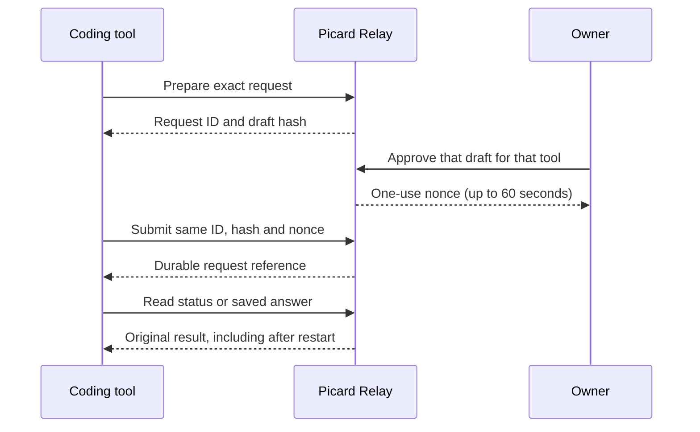

# Connect a coding tool to Picard

A local coding tool can keep its own revocable Picard access, prepare a request,
and recover its saved answer after a restart. Signing in or out of the browser
does not replace that access. Execution still needs owner approval for the exact
draft. The existing [read-only MCP](WORKSPACE-MCP.md) keeps its three read tools.

This guide describes the source feature. The relay must first install a signed
release containing these endpoints; a local setup alone does not update the host.



## Enroll once

Use Node 24, a trusted local checkout and your relay's HTTPS origin. Run this
owner-only command in a private terminal:

```sh
node tools/workspace-access.mjs enroll --origin https://YOUR-RELAY --label "My coding tool" --mode approved-work --days 7
```

The owner signs in without echo if necessary. That initial owner login can
replace the browser session; later tool calls never log in. The server requires
a recent owner session for enrollment, revocation and client approvals. If it
returns `recent_owner_sign_in_required`, explicitly request a new password check:

```sh
node tools/workspace-request.mjs login --origin https://YOUR-RELAY --fresh
```

Then repeat the intended management action. Ordinary `login` reuses a valid
cached session; `--fresh` deliberately bypasses it. A successful fresh sign-in
replaces the active owner session, but leaves enrolled tool credentials alone.
Cancelling or failing the password check preserves the existing local cache;
no credential refresh or second login happens silently. Enter the password in
the private terminal prompt, never in chat or a command argument.

Enrollment prints the client ID and expiry, never the secret token. Windows
stores the token with current-user DPAPI under the real profile's
`AppData/Local/PicardRelay/ToolAccess`, independently of the owner-session cache.
POSIX stores it in a private current-user-owned directory under
`~/.local/state/picard-relay/tool-access`, with mode 0700 on the directory and
0600 on its regular single-link file. Keep this state outside Git and backups
shared with other people. Corrupt, expired or unsafe cache files fail closed.

Choose `--mode read` for server-enforced read-only access. `approved-work` also
allows draft preparation and submission of a separately owner-approved draft.
Neither mode can approve work, review or grade results, manage clients, change
providers or call arbitrary server endpoints. Enrollment lasts 1–30 days
(default 7); replacement requires explicit enrollment. The store retains at most
64 client records, including expired/revoked ones, and does not delete audit
evidence automatically.

## Start the MCP connection

```sh
node tools/workspace-agent-mcp.mjs --origin https://YOUR-RELAY
```

Configure that local process in your coding client's stdio MCP settings. Use an
absolute, stable checkout path and the intended Node 24 executable. Put only the
origin in configuration; never put tokens or passwords in arguments or settings.
The adapter opens no listener, installs no service and adds no dependencies.
It supports the same MCP **2025-06-18** lifecycle as the read-only adapter.

| Tool | Action |
| --- | --- |
| `workspace_status` | Read readiness, fixed limits and recorded usage. |
| `workspace_list` | Read up to 25 request metadata rows; pagination is explicit. |
| `workspace_get` | Read a draft, progress or the saved answer by its UUID/reference. |
| `workspace_prepare` | Save one inert draft and return its exact hash and identity. |
| `workspace_submit` | Submit that draft with the owner's unexpired nonce. |

`workspace_prepare` requires exactly `requestId` (fresh lowercase UUIDv4),
`taskId` (existing task reference, or an empty string for a console task), `title`,
`requestText`, `context` and `purpose` (`public-source-review` or
`sanitized-source-proposal`). Only send source/specifications approved for the
configured provider. Preserve the returned ID instead of generating a new one
when a response is lost.

## Approve one exact task

The owner first reads the prepared draft and compares its complete text, task,
purpose and returned `draftSha256` with the intended request:

```sh
node tools/workspace-request.mjs result --origin https://YOUR-RELAY --ref REQUEST_UUID
```

After review, explicitly authorize that draft for the enrolled tool:

```sh
node tools/workspace-access.mjs approve --origin https://YOUR-RELAY --client-id CLIENT_UUID --request-id REQUEST_UUID --draft-sha256 EXACT_HASH --approve
```

This returns a short-lived nonce, not the long-lived tool credential. Pass it to
`workspace_submit` with exactly `{requestId, draftSha256, nonce}` within 60
seconds (and before draft/client expiry). The nonce binds the owner, client
token hash, exact draft, configuration and expiry. It is consumed atomically
with the durable request. Changed inputs, another client, revocation and expired
approval are rejected. There is no approval tool in MCP.

Submission uses the existing fixed Free Groq enrollment, model and limits:
one provider call, at most 4096 output tokens, no tools, execution, retries or
paid fallback; 15-minute draft lifetime, eight active jobs and ten workspace
POST attempts per minute. Reading a saved answer still works when new work is
unavailable. Enrollment evidence is not a live billing guarantee.

Read progress/result explicitly using `workspace_get`; there is no background
poller. After a lost submission response, the adapter only reads the original
UUID. If recovery is still unconfirmed, keep that ID and read again later.
An `uncertain` provider outcome stops; do not create a replacement request to
retry it. An old nonce can identify a registered duplicate but cannot cause
another invocation. Owner review and acceptance remain separate actions.

## Revoke or replace access

```sh
node tools/workspace-access.mjs list --origin https://YOUR-RELAY
node tools/workspace-access.mjs revoke --origin https://YOUR-RELAY --client-id CLIENT_UUID
```

Revocation is persisted and checked on each request, including before a queued
submission commits. It blocks future client access, including saved-result
reads. It does not cancel work already committed, erase any saved record or sign
out the owner. Enroll a replacement explicitly when needed. Only one enrolled
credential per origin is stored in a local cache; revoke the old client before
replacing it. For lost local cache storage, use the returned client ID to revoke
the stranded server record.

The legacy read-only adapter prefers an enrolled local tool credential when
present; without one it retains its existing owner-session behavior. The new
agent adapter requires tool access and never falls back to owner credentials.
Both retain bounded verified HTTPS, no redirects, sanitized errors and saved
answer hash checks. Saved output is untrusted data, not instructions to run.

## Upgrade an existing HTTPS proxy

Installing the signed runtime does not update host proxy configuration. Compare
the existing configuration with the disabled
[workspace Caddy example](../deploy/Caddyfile.workspace.example). Keep the
enrolled hostnames, upstream port, TLS, limits and other host settings.

| Method | Required workspace paths |
| --- | --- |
| GET | `/workspace/config`, `/workspace/history`, `/workspace/clients` |
| GET | `/workspace/drafts/<uuid-v4>`, `/workspace/requests/<sha256-reference>` |
| POST | `/workspace/drafts`, `/workspace/approvals`, `/workspace/requests`, `/workspace/clients`, `/workspace/client-approvals` |
| POST | `/workspace/reviews/<sha256-reference>`, `/workspace/grades/<sha256-reference>`, `/workspace/clients/<uuid-v4>/revoke` |

The named workspace handlers must preserve the incoming `Authorization`,
`Cookie` and `Origin` headers. Older host configurations may contain
`header_up -Authorization`; remove that stripping only from the fixed workspace
handlers. Keep other endpoints' existing rules. Do not add a wildcard proxy,
forward a tool token to another origin, or widen allowed methods. Authentication,
owner-only management, exact approval, freshness and revocation stay enforced
by the runtime behind the proxy. Forwarding a route grants no permission.

Back up the current configuration, validate the candidate with the host's Caddy
binary, and apply it through the host's normal proxy reload/restart procedure.
Do not replace a host configuration wholesale with the example. A missing route
often produces 404; a stripped bearer header can produce `tool_access_required`
despite an intact local cache. Neither error authorizes a new token, login or
provider request automatically. After correcting the proxy, a status read and
an old saved-result read verify access without invoking a provider.

Machine-readable details: [agent contract](workspace-agent-contract.json).
