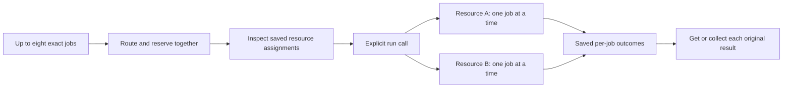

# Bounded routing and execution

The compute broker can route a small group of approved jobs and run independent
resources together. It reuses the existing SQLite ledger and fixed workers.
It adds no service, background queue, polling timer or database migration.
This separate MCP process is not part of the signed console runtime.



## Submit, inspect, then run

1. For live work, refresh the existing enrolled resources. Each job still needs
   its own exact job/resource approval, fresh zero-dollar evidence and sufficient
   capacity. Batch membership grants no authority. No enrollment is renewed.
2. Call `compute_submit_batch` with `{ "jobs": [JOB_ONE, JOB_TWO] }`, using the
   ordinary [job schema](README.md#connect-an-ai-client). The response contains
   `executionStarted: false` and one `{ id, state, resourceId }` per job.
3. Inspect the routes. Call `compute_plan` for an individual blocked job's reason,
   or `compute_get` to inspect a saved job. Submission never contacts a worker.
4. Call `compute_run_batch` with `{ "ids": ["job-one", "job-two"] }`.
   It rechecks each reserved job's existing authority, resource and capacity.
5. Read each full saved answer with `compute_get`. For a pending or uncertain
   original invocation, use `compute_collect`; collection never dispatches.

The existing demo uses local fixtures only:

```sh
npm --prefix experimental/compute-broker run demo
```

Live operations remain Oracle word count/SHA-256 and GitHub checks of this public
repository at an exact reviewed source commit. This does not add a shell,
generated-code execution, additional providers or paid fallback.

## Limits and partial outcomes

- One to eight distinct job IDs; combined normalized job JSON at most 49,152
  UTF-8 bytes (48 KiB). The existing per-job input and MCP frame limits also apply.
- Invalid members, duplicate IDs and changed input under an existing ID reject
  admission without leaving partial new rows or allocations. A valid but
  ineligible job is saved as blocked; other eligible members can be reserved.
- Routes and original execution contexts stay fixed once saved. No rerouting
  after a failed, pending or uncertain attempt; CPU budgets are never refunded.
- At most two selected resource groups dispatch concurrently, with sequential
  jobs inside each resource. Unresolved selected groups hold parallel slots.
  If both slots are held, unstarted jobs remain reserved.
- Only one distinct batch dispatch is active per process. An identical in-flight
  call joins that batch; another list returns `batch_execution_busy`. Existing
  SQLite reservations and compare-and-swap protect jobs across processes.
- Execution is not an all-or-nothing transaction: one resource may complete while
  another fails or remains pending. Terminal and unresolved jobs are not resent.
- A failed or unavailable execution stops later members on the same resource.
  Another independent resource may continue within the parallel bound.

Batch responses contain only job IDs, routes, saved states and bounded disposition
codes: `observed`, `unchanged`, `deferred` or `unavailable`. They do not concatenate
answers, logs or private inputs. `resource_execution_stopped` and
`parallel_capacity_held` leave a job reserved; no background work starts later.

## Restart and recovery

Each member is durable; the batch itself has no separate queue or completion
ledger. After restart, get each original ID. Repeating exact submission returns
its existing state. A run call skips completed, failed, blocked, invoking,
pending and uncertain jobs. Only a still-reserved original job can start, after
fresh checks, and only when explicitly requested.

Collect an original unresolved result before requesting later work on its
resource. If all processes sharing the ledger are stopped, the existing explicit
offline `recover()` operation can mark interrupted invocation intents uncertain;
it never resends them. Keep the original context, keys and worker source for
receipt lookup. Missing evidence remains unavailable, not permission to retry.

The current profile permits two fixed providers and eight exact approvals.
New batch tests use simulated transports; they do not renew old live allowances
or establish current Oracle billing eligibility. General cloud orchestration,
multiple hosts sharing SQLite and an account-wide zero-dollar guarantee remain
outside this feature.
