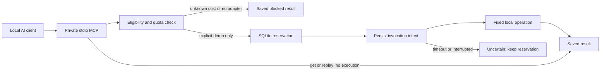

# Compute broker preview

**Status: offline execution foundation with live read-only Oracle inventory and project CI observation, November 4, 2026. No live compute executor is enrolled.** This package lets an AI client discover a registry, plan a small job, reserve capacity, execute an explicitly enabled local fixture and retrieve its saved result. It can also read the configured Oracle micro VM's current capacity and this public project's GitHub CI status for an exact commit. It is a separate process and database from Picard's live AI-request relay. Picard generated an initial eligibility-selector proposal; reviewed corrections are described in [PROVENANCE.md](PROVENANCE.md).

The requested network still needs secure real-provider adapters and successful execution across two independent providers. Two simulated architecture resources are not two cloud providers. This code is outside the signed runtime allowlist and is not deployed by Picard's updater.

## Try it

Use Node 24. No installation, dependencies, credentials, listener or provider calls are needed.

```sh
npm --prefix experimental/compute-broker run demo
npm --prefix experimental/compute-broker test
npm --prefix experimental/compute-broker run test:jitless
```

The demo runs two independent local jobs, routes by requested x64/arm64 label, prints their saved results and replays the first submission. Both execute in the current Node process; it neither emulates nor tests ARM hardware. Its temporary ledger is removed after the demonstration. `realCloudProvidersExecuted` is explicitly zero. Tests use private temporary databases and local fixtures.

## How it works



1. A strict job schema accepts only `word-count` and `sha256` on at most 12,000 UTF-8 input bytes. No command, code, path or environment field is accepted.
2. Selection requires unique bounded IDs, supported operation/architecture, positive safe-integer requirements, enough capacity and a free slot. Observations must be no older than 60 seconds. Cost evidence must be no older than 24 hours, not future-dated, unexpired and explicitly zero incremental dollars. Trials, paid and unknown classes are rejected. CI resources only accept project CI workloads. Ties use lexical resource ID order.
3. `compute_submit` atomically saves the exact normalized job and its reservation. Reusing an ID with identical input returns the existing job. Changed input produces `job_identity_conflict`; blocked/failed/uncertain IDs also remain terminal.
4. `compute_run` rechecks eligibility and reservation fit, then commits `invoking` before any adapter call. A conditional transition permits only one invocation even across connections. Concurrent calls may see `invoking`; check the saved job again instead of submitting another identity.
5. A valid reply is saved as `completed`. Timeouts, thrown errors, non-JSON or oversized replies stop as `uncertain`, keep capacity reserved and never retry or fail over. Reading a saved result does not execute anything.

CPU milliseconds are a conservative **requested budget**, not measured usage or a provider quota conversion. Allocated CPU is never refunded or reset automatically. Slots, RAM, disk and GPU reservations are released only for known completed/failed states; uncertain jobs retain them. This does not impose OS memory/CPU limits. The two tiny built-in operations have bounded input and produce JSON results up to 16 KiB. There is no arbitrary job executor, GPU implementation, artifact filesystem, cancellation of remote work or scheduler queue.

## MCP connection

The server implements newline-delimited JSON-RPC over [MCP stdio, protocol 2025-06-18](https://modelcontextprotocol.io/specification/2025-06-18/basic/transports). It writes protocol responses to stdout; Node warnings use stderr. Initialize the connection, send `notifications/initialized`, then list/call tools. HTTP, OAuth, subscriptions and compatibility with every MCP client are not claimed.

Use absolute paths appropriate to your computer in your client's MCP configuration:

```json
{
  "mcpServers": {
    "picard-compute-preview": {
      "command": "/absolute/path/to/node24",
      "args": [
        "/absolute/path/to/picard-relay/experimental/compute-broker/mcp.mjs",
        "--db", "/private/compute-state/ledger.sqlite"
      ]
    }
  }
}
```

Execution is disabled by default. Add `--demo` only to enable the two **local fixtures**. No switch enables live cloud execution. State persists across client restarts; the demo command uses disposable state, whereas the MCP server keeps its ledger. There is no automatic quota reset. The process inherits your local account's authority: connect only trusted local clients. On POSIX the immediate state directory must be owned by that account and mode 0700; the regular database must be mode 0600. On Windows, use a private account-protected folder; ACL enforcement has not been qualified. Do not point this process at Picard, task-board or any other production database. It refuses unrelated SQLite application IDs/tables.

| Tool | Behavior |
| --- | --- |
| `compute_discover` | Registry, remaining reservations, explicit execution mode. Empty arguments. |
| `compute_plan` | Eligibility decisions without writing or invoking. Full job input. |
| `compute_submit` | Persist exact input and reserve capacity, or save a terminal blocked result. |
| `compute_run` | Invoke a reserved local fixture once. Input `{ "id": "sample-one" }`. |
| `compute_get` | Saved job/result by ID; unknown ID returns null. |
| `compute_list` | Up to 100 recent jobs. Empty arguments. |
| `compute_ci_status` | Live read-only GitHub CI for `{ "commitSha": "<40 lowercase hex characters>" }` in `bmartynowicz/picard-relay` only. |
| `compute_oracle_status` | Live read-only VM inventory with empty arguments. Requires an explicit private SSH profile; otherwise returns `configured: false`. |

Example job for `compute_plan` or `compute_submit`:

```json
{
  "id": "sample-one",
  "operation": "word-count",
  "workload": "data",
  "arch": "any",
  "needs": { "cpuMs": 100, "ramMb": 32, "diskMb": 0, "gpus": 0 },
  "input": { "text": "A small saved result" },
  "timeoutMs": 1000
}
```

Jobs use `reserved → invoking → completed | uncertain`; a pre-invocation eligibility change produces `failed`. Ineligible submissions start and stay `blocked`. The job ID binds the normalized input, not a user identity or provider approval. This single-account preview has no network authentication or tenant isolation.

Brian selected **GitHub public-project CI** for the second backend on November 4. `compute_ci_status` provides its first live integration: up to three public HTTPS GET requests, each with a five-second deadline and 128 KiB response ceiling, check the public repository, matching pull-request workflow run and up to ten jobs. It does not use credentials, follow redirects, dispatch, rerun, download artifacts or retry. Rate limits/unavailable APIs return an error; a missing matching run returns `found: false`. It reads at most the first three run matches for the commit, and reports truncation for job/step lists. Call it explicitly; discovery/demo/tests do not contact GitHub. This is current provider data, separate from the private saved fixture ledger.

The [first public CI run](https://github.com/bmartynowicz/picard-relay/actions/runs/41889597537) passed for commit `2aca378414d18cb1c524e7a1eb1bbb3db8cc0ec1`. That proves this repository's fixed CI checks ran on GitHub; it does not prove broker-driven dispatch or completion of the two-provider network.

For Oracle observation, pass `--oracle-profile /private/path/oracle.json` in the MCP command. Copy [oracle-profile.example.json](oracle-profile.example.json) to a private location and replace its values with an **existing authorized** SSH host, user, private-key path, known-hosts path and absolute trusted SSH executable. Windows paths can use forward slashes in JSON. Do not put real profiles or keys in this repository. On POSIX, the profile must be an owned regular non-symlink file, mode 0600, at most 8 KiB. Windows ACL enforcement is not qualified. The operator controls this trusted local configuration; ordinary MCP callers cannot supply a host, command, executable or profile.

`compute_oracle_status` starts one fixed read-only Python probe over pinned SSH. It disables user SSH configuration, agent use/forwarding and extra port forwards, requires the existing known-host entry, permits one connection attempt, caps stdout at 16 KiB and stops the local SSH process after eight seconds. Concurrent requests share one probe within the MCP process. It reads only selected instance metadata, OS memory and root-filesystem capacity. No package/worker is installed and no root command, job, resource creation or account API is used. The current implementation accepts the inspected x64 E2.1.Micro shape only. Transport errors are sanitized; there is no reconnect/retry. The existing key's privileges are not reduced by this observer; a future executor needs a dedicated restricted worker identity.

The Oracle tool deliberately returns `accountQuota: null`, `costVerification: "unknown"` and `dispatchEnabled: false`. Logical CPUs and available RAM are machine measurements, not free-tier entitlement or scheduling capacity. The authenticated Console assessment below is a separate dated manual observation; it does not automatically enable execution.

For actual process interruption, stop **every** broker sharing the database before manually calling the library's `recover()` in an offline maintenance process. It changes `invoking` to `uncertain`, preserves reservations and never resends. Startup does not auto-recover another process's in-flight work. Backup/restore, disk-full, power-loss and multi-host database operation remain unqualified.

## Provider readiness and next steps

The [provider research](PROVIDERS.md) and [structured contract](contract.json) distinguish public allowances, account verification and executable adapters. An evidence reference in the selector is operator-supplied metadata, not an independent billing check or enforceable spending cap. Synthetic evidence is clearly labeled in demo resources. Defaults achieve zero cloud calls by disabling cloud execution; they do not establish a live zero-dollar network.

The authenticated Oracle Console check confirmed the existing micro VM is labeled **Always Free**, with one of two micro instances used in its availability domain and one 50 GB boot volume without additional attached disks. Permanent resource eligibility was checked separately from promotional credits. Cost overview and subscription pages remained blank through direct and in-console navigation, so current charges, remaining trial credits, trial expiry and complete billing controls were not verified. Trial credits remain excluded; no account upgrade, new resource or quota change was made. See [provider assessment](PROVIDERS.md).

The next implementation should enroll the existing Oracle VM and GitHub public-project CI after checking preventive cost controls, workload permissions and available access. GitHub standard public runners are for this project's CI jobs only; the current CLI identity has read access and no workflow-dispatch authority. General data jobs need an eligible VM or other permitted backend. Do not treat CI/notebook accounts as unrestricted remote workers.

Before live enablement, add pinned/authenticated transports, fixed allowlisted operations with OS resource controls, exact job authority, independent cost/quota refresh, safe artifact/log retrieval, provider-specific uncertainty reconciliation, and two-provider end-to-end evidence. Keep this package isolated from the production relay until that work is reviewed. Picard's additional AI-model connector task remains separate and paused.

For opt-in compute nodes, the proposed next transport is an authoritative coordinator with trusted workers polling over authenticated outbound HTTPS. Advertise exact capabilities and capacity; bind each attempt to a fenced worker identity and recover saved results without resending uncertain work. Never share SQLite WAL over a network filesystem or distribute master credentials. This transport is a design direction, not implemented by the local fixture adapters. More proxies sharing one Groq organization do not create more provider quota. Independent permitted compute workers or separately authorized providers can add throughput; additional nodes alone do not improve model quality. The synthetic two-worker overlap/loss test demonstrates local orchestration only, not model throughput.

## Verification scope

The suite checks strict eligibility, duplicate IDs, the CI restriction, durable replay, changed-input rejection, shared-ledger reservations, at-most-once invocation intent, timeout/late-result handling, restart recovery, private state and real MCP child-process exchanges. See [VERIFICATION.md](VERIFICATION.md) for dated results and qualification limits.
