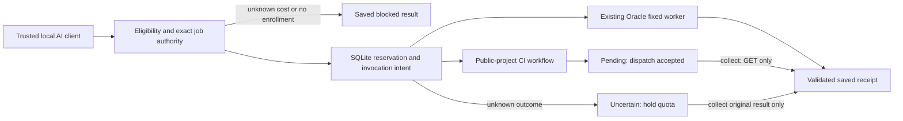

# Compute broker preview

**Status: opt-in adapters with dated Oracle and unattended GitHub qualification; source defaults remain disabled.** This separate Node 24 process lets an AI client discover eligible resources, reserve an exact approved job, invoke it once and recover its saved result. Individual qualification requests are consumed. It does not change Picard's production AI-request relay, credentials or database, and is outside the signed updater artifact. Coding agents start with [the prepare/collect guide](CODING-WORKFLOW.md).

Oracle accepts two small fixed operations on an existing Always Free E2.1.Micro VM: word count and SHA-256. GitHub accepts this public project's fixed checks for an exact source commit. Worker v2 covers root tests, updater, signed runtime, real sockets, broker normal/jitless and documentation, returning each group exit code. The protected, pinned source candidate passed a real Picard request for all seven groups; see [dated evidence](VERIFICATION.md). Legacy worker-v1 broker-only results remain readable. It is not a general cloud shell, generated-code executor or GPU network. Two fixture resources are not two live providers.

## Try without a cloud account

```sh
npm --prefix experimental/compute-broker run demo
npm --prefix experimental/compute-broker test
npm --prefix experimental/compute-broker run test:jitless
```

These commands need no credentials or dependencies and make no provider calls. The demo uses disposable private SQLite state and returns `realCloudProvidersExecuted: 0`. The tests use local processes and synthetic transports. Use Node 24; qualification and remaining limits are in [VERIFICATION.md](VERIFICATION.md).

## How a job moves



1. Normalize the strict job schema and bind the full input, including ID, to SHA-256. Input is at most 12,000 UTF-8 bytes. Unknown command, code, path or environment fields are rejected.
2. Require fresh observations (60 seconds), unexpired zero-dollar cost evidence (at most 24 hours old), supported operation/architecture, remaining capacity and an exact job/resource approval. Trials, paid and unknown cost classes are rejected. Retained evidence is not an independent billing guarantee.
3. Atomically persist the job, original execution context and capacity reservation. Identical resubmission returns the existing row; changed input under the same ID fails. A blocked ID remains blocked.
4. Recheck eligibility and authority, commit invocation intent, then call the adapter once. No retries, alternate providers or paid fallback. Admission denial before dispatch is known failed. Transport loss, timeout or invalid receipts are uncertain and retain capacity.
5. Oracle returns a bounded receipt. GitHub dispatch acceptance produces `pending`; `compute_collect` checks the original run and saves a validated terminal receipt. Collection never dispatches, even after approval expires or execution is disabled.

`reserved → invoking → completed | failed | uncertain`; GitHub can also pass through `pending`. Completed/failed states release slots/RAM/disk, but CPU budget is never refunded. Pending/uncertain states retain reservations. CPU milliseconds are conservative admission units, not measured usage or a conversion of provider quotas. Nothing resets quotas or renews approvals automatically.

Receipts bind job ID, input hash and worker-source hash; reject executable/non-JSON data, hidden/accessor fields, excessive nesting and mismatched identities; and enforce 16 KiB total UTF-8 size, eight 256-byte log tails and one inline `result.json` artifact of at most 4 KiB with byte count and SHA-256. See [Picard provenance](PROVENANCE.md).

## Route several jobs

Use `compute_submit_batch` to reserve up to eight exact jobs together, inspect
their assigned resources, then call `compute_run_batch` with their saved IDs.
Independent resources can run in parallel, at most two at a time; jobs on the
same resource run sequentially. Pending or uncertain outcomes keep their slot
and stop later work on that resource. Each result stays in the existing ledger
and is recovered individually with `compute_get` or `compute_collect`.

The [batch guide](BATCHES.md) covers input limits, partial outcomes, restart
recovery and exact approvals. No new daemon, polling loop, database schema or
execution privilege is introduced. This is source functionality in the separate
compute broker, outside the signed console runtime; it does not activate workers.

## Unattended public CI

An opt-in [native CI dispatcher](UNATTENDED.md) runs the actual MCP broker with GitHub's ephemeral repository token, so it needs no browser or personal token. Ordinary branches remain disabled; only an explicitly authorized owner request on a matching compute-request branch can dispatch one fixed worker job. This is CI-hosted orchestration, not an external credential-free API gateway. Live qualification is recorded separately.

## Connect an AI client

The server implements newline-delimited [MCP stdio, protocol 2025-06-18](https://modelcontextprotocol.io/specification/2025-06-18/basic/transports). Initialize, send `notifications/initialized`, then list/call tools. It has no HTTP listener, OAuth or tenant isolation; connect only trusted local clients.

```json
{
  "mcpServers": {
    "picard-compute-preview": {
      "command": "/absolute/path/to/node24",
      "args": [
        "/absolute/path/to/picard-relay/experimental/compute-broker/mcp.mjs",
        "--db", "/private/compute-state/ledger.sqlite"
      ]
    }
  }
}
```

Add `--demo` only for fixtures. For enrolled workers use `--execution-profile /private/execution.json` after completing [EXECUTION.md](EXECUTION.md). Modes cannot be combined. No provider is contacted on startup; explicitly refresh readiness before planning. The disabled [example profile](execution-profile.example.json) has expired placeholders and no approved jobs, so cannot run as copied.

On POSIX, immediate state directories must be owned mode 0700 and database/profile files owned mode 0600, regular and non-symlink. On Windows use a private account-protected folder; ACL enforcement remains unqualified. Never use a production Picard or task-board database. Unrelated SQLite application IDs/tables are refused.

| Tool | Behavior |
| --- | --- |
| `compute_discover` | Saved registry and remaining reservations; no network call. |
| `compute_refresh_resources` | Bounded read-only readiness probes; no renewal or dispatch. |
| `compute_plan` | Eligibility without reservation or execution. |
| `compute_submit` | Save exact job and reserve capacity, or save blocked result. |
| `compute_submit_batch` | Atomically save up to eight exact jobs and their routes; no execution. |
| `compute_run` | Invoke once. Input `{ "id": "sample-one" }`. |
| `compute_run_batch` | Dispatch saved IDs with bounded parallelism; return routing/state summaries. |
| `compute_collect` | Retrieve pending/uncertain outcomes from the original provider; never resubmit. |
| `compute_get` | Saved job/result by ID; unknown ID returns null. |
| `compute_list` | Up to 100 recent local jobs. |
| `compute_ci_status` | Credential-free GETs for an exact commit's normal project CI status. |
| `compute_oracle_status` | Read-only inventory through `--oracle-profile PRIVATE_FILE`; no enrollment/billing claim. |

Example **local fixture** job:

```json
{
  "id": "sample-one", "operation": "word-count", "workload": "data", "arch": "any",
  "needs": { "cpuMs": 100, "ramMb": 32, "diskMb": 0, "gpus": 0 },
  "input": { "text": "A small saved result" }, "timeoutMs": 1000
}
```

Live Oracle jobs reserve exactly 3,000 CPU units and 96–128 MiB RAM, no GPU and at most 1 MiB declared disk; use a 30-second transport deadline. GitHub jobs use `project-checks`, workload `project-ci`, `input.text` equal to an exact approved 40-character lowercase source SHA and 360,000 CPU admission units. That is a finite scheduling budget, not measured runner CPU entitlement. The workflow has a three-minute wall-clock limit.

## Live observation and deployment boundary

Brian selected GitHub public-project CI as the second backend. The original status tool read real run [41889597537](https://github.com/bmartynowicz/picard-relay/actions/runs/41889597537) without dispatch. Oracle inventory was also read through existing pinned SSH and real MCP. These prove observation, not broker-driven execution.

The Oracle Console showed the existing VM's Always Free label, domain quota of two with one used, one 50 GB boot volume and no additional attached block disks. After intermittent blank pages, Cost Analysis loaded **$0.00 for November 1–4, 2026**, with an approximately 24-hour delay; the account still displayed Free Trial. Promotional credits are excluded. No upgrade, quota change or resource was created. Complete preventive account controls remain unverified. See [PROVIDERS.md](PROVIDERS.md).

The adapters remain disabled by default. Dated follow-up qualification completed one restricted Oracle job and an unattended GitHub job; those allowances are consumed, not reusable enrollment. PR #10 merged the opt-in GitHub lane. See [verification evidence](VERIFICATION.md), [unattended dispatch](UNATTENDED.md) and [the coding-agent prepare/collect workflow](CODING-WORKFLOW.md). The private board is the operational backlog; [contract.json](contract.json) supplies the machine-readable boundary.

Stop every broker sharing a database before explicitly calling library `recover()` during offline maintenance. It turns interrupted `invoking` rows uncertain and never resends. Startup does not overwrite another process's in-flight work. Preserve original profile context, keys and worker source to recover old results; changed context blocks collection. Never share SQLite WAL over network filesystems.
