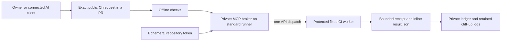

# Unattended GitHub dispatch without a browser

This opt-in lane runs the real compute MCP broker inside GitHub Actions. GitHub supplies a short-lived repository credential; the broker makes one REST `workflow_dispatch` call to the protected fixed worker, collects its receipt and checks saved-result recovery after restarting without credentials. No personal token, browser session, new cloud resource or paid fallback is involved.

**Source candidate, not yet a live-verification claim.** It is separate from Picard's production AI-request relay. Outside GitHub Actions, an MCP client still needs its own approved credential or dispatch integration; this does not expose a public MCP endpoint.

## Submit one bounded request

1. Start an owner-authored branch named `compute-request/JOB_ID`. Commit an explicitly authorized `unattended-request.json` under this package and open its pull request through the existing GitHub connection. Ordinary branches do not enable dispatch. The qualification request in this candidate is one public-project test job against exact source `b928ef2a10c7792a9c709f38a8065373d76160b4`; its absolute expiry does not renew.
2. The existing compute-broker workflow runs offline tests first. Only the fixed repository, public-repository event, owner actor/PR author, same-repository head and first attempt can enter the dispatch job. Forks, `pull_request_target`, reruns and unrelated branches are excluded. This is a trusted-owner workflow, not an external-contributor execution service.
3. The broker checks the public repository, pinned worker ref/commit and exact free workflow bytes, reserves one job, persists invocation intent and calls the API once. Explicit collection uses GETs; uncertainty never produces another execution attempt. A second coordinator run for the same request branch is rejected using retained GitHub run history. Incomplete/truncated history also stops.
4. Review the coordinator's `PICARD_UNATTENDED_RESULT_V1` record and the correlated worker run. It contains exact job/source/worker identities, receipt/log tails/inline artifact and the restart-recovery result. A `PICARD_UNATTENDED_STOP_V1` record is a stop requiring investigation, not permission to rerun or rename an uncertain job.

The request has exactly `schemaVersion`, `enabled`, `approvedAt`, `validUntil`, `workerRef`, `workerCommit`, `workerSha256` and `job`. Approval must be current, at most 24 hours long, and explicitly enabled. Only `project-checks` on an exact public source SHA is accepted, with one 360,000-unit CPU reservation, 4096 MiB declared RAM, zero declared disk and no GPU. The job ID and full normalized input are bound by SHA-256. The worker source must match the enrolled hash; never move `compute-worker-v1` to install a new version.

An owner publishing an explicitly authorized request is the approval step. A work-register entry, old result, missing run or expired allowance supplies no new authority. Do not commit private data, secrets, actual credentials or a copied private execution profile.

## Credential and cost boundary

The dispatch job gets **Contents read and Actions write** only. GitHub creates the ephemeral `GITHUB_TOKEN` for this repository; only the dispatch step passes it to the broker through its dedicated environment variable. The generated private profile contains the variable name, not the secret. Checkout does not persist credentials. The fixed worker's test subprocesses receive only a minimal non-credential environment.

Both jobs use standard `ubuntu-latest` runners in this public repository, bounded to three minutes per job. The worker workflow has no artifact/cache uploads, matrix, cloud credentials or runner-selection input. Results are inline JSON and log tails. [Standard public runner compute is free](https://docs.github.com/en/billing/concepts/product-billing/github-actions); larger runners and storage have separate billing rules and are excluded. GitHub explicitly permits [workflow_dispatch using GITHUB_TOKEN](https://docs.github.com/en/actions/how-tos/write-workflows/choose-when-workflows-run/trigger-a-workflow). No new personal credential or account upgrade is required.

The read-only ordinary test job does not gain Actions write. The privileged job runs reviewed code from the trusted owner's request branch; other people must not be allowed to push code under that identity. Operator/account changes outside this workflow can invalidate retained eligibility or protection assumptions. This is not an independent account-wide billing cap.

## State and limits

The coordinator uses a new private runner directory, owned 0700 on Linux, with mode-0600 profile/database files. SQLite records the exact job and original worker context before invocation; a second MCP process reads its saved result with execution disabled and without the token. No consumed/uncertain state is deleted by the harness.

The runner's local disk is ephemeral. GitHub retains coordinator run history, invocation/result log records and the worker receipt subject to its retention and administrative controls. History/attempt guards stop duplicate dispatch while that evidence is retained. Do not delete run history to bypass a stop. This is not a permanent multi-host SQLite store or a guarantee against out-of-band administrator changes. External durable orchestration, disaster recovery and cross-account service operation remain separate qualification work.

The orchestrator calls `compute_run` once, then performs at most 18 saved-result collection reads with five-second waits. Collection never dispatches. It has no automatic rerun, provider/model substitution, quota reset or approval renewal. The per-job CPU value is a scheduling reservation, not a measured provider entitlement. GitHub queueing, rate limits, log retention and runner availability remain provider constraints.
