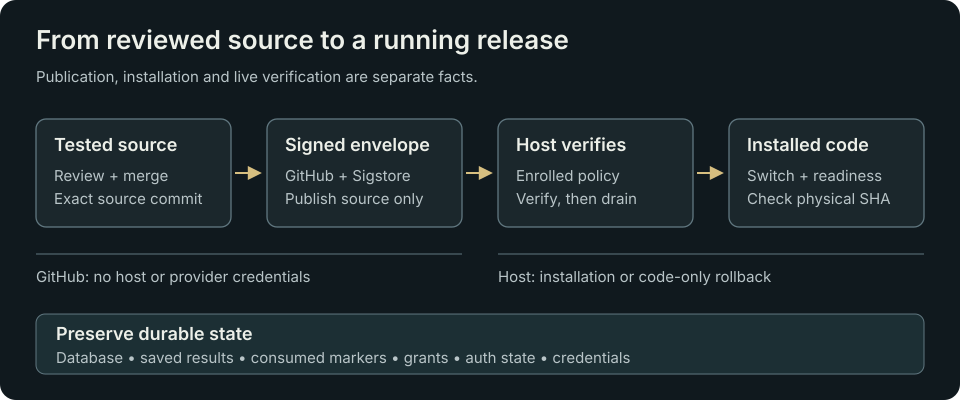

# Signed source updater

The updater is host support code, installed/enrolled independently of the replaceable runtime source. Disabled repository examples do not activate it. Use the [operations runbook](../../docs/OPERATIONS.md) for current installation, verification, troubleshooting and recovery.

## Publication and trust

The fixed publication is `releases/stable.json`. GitHub Actions tests on Node 24.22.1, builds the 20-module runtime allowlist, signs the manifest using ephemeral Sigstore identity and publishes the source envelope. It never deploys, SSHs or receives VM/provider credentials.

The verifier pins repository, main workflow identity and issuer, and verifies source commit, hashes, schema, expiry and monotonic sequence. A root-controlled cosign binary and trust root are installed separately. A valid signature identifies trusted publication; it is not a proof that code is safe or that a host has installed it.

## Host transaction

The separately configured unprivileged fetch service downloads a bounded untrusted envelope into its private inbox. The privileged installation unit allows Unix sockets and denies IP networking. It verifies the envelope before staging, confirms drain before stopping the one fixed service, journals before switching the current source link and verifies readiness. Failed candidate readiness triggers code-only rollback; uncertain drain does not force a stop.

Pending journal, unsafe ownership, operator HOLD, invalid source or verification failure stops progress for review. Never clear these automatically to retry. Do not restore a database or consumed invocation marker during rollback.

The conventional updater timer checks every five minutes with up to 30 seconds of randomized delay. This schedule exists only on enrolled hosts; publication alone does not activate it.

## Read-only activity

`activity-report.mjs` and its separate one-minute timer publish `/var/lib/picard-updater-status/status.json`. The observer reads only enabled policy, HOLD presence and fixed systemd metadata. It writes typed state, flags and attempt/outcome timestamps; it cannot start an update and exposes no private logs or credentials.

The authenticated console rejects unsafe, oversized, malformed, stale or materially future observations. Installed source identity and last-check success remain separate. The observer script, units and precise SELinux read-only metadata labels are host support outside the 20-module runtime bundle.

## Qualification

Run `npm --prefix experimental/updater test` with Node 24 and OpenSSL on Linux. Tests use mocked provider behavior and local TLS/transaction fixtures; no live model is called. Dated installed-source evidence belongs in [Status](../../docs/STATUS.md). Arbitrary crash/power-loss/disk-full behavior and general host bootstrapping are not established by synthetic transaction tests.

Host configuration, credentials, grants, ledger, firewall/proxy/SELinux configuration, Node binary and schema migration are outside the source update scope.

## Owner-request candidate

`owner-request.mjs` plus `picard-owner-update.path`/`.service` provide a separately enrolled fixed request for the existing updater. They add no generic command or network listener. Read the [host checklist](../../docs/OWNER-UPDATES.md) before installation. Runtime source alone cannot activate this bridge.
